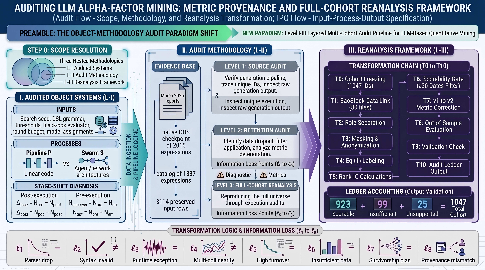

# **`README.md`**

# Auditing LLM Alpha-Factor Mining: Metric Provenance and Full-Cohort Reanalysis

<!-- PROJECT SHIELDS -->
[](https://opensource.org/licenses/MIT)
[](https://github.com/chirindaopensource/auditing_LLM_alpha_factor_mining)
[](https://www.python.org/)
[](https://peps.python.org/pep-0008/)
[](https://peps.python.org/pep-0484/)
[](https://numpydoc.readthedocs.io/en/latest/format.html)
[](https://arxiv.org/abs/2610.29500)
[](https://arxiv.org/abs/2610.29500)
[](https://arxiv.org/abs/2610.29500)
[](https://arxiv.org/abs/2610.29500)
[](https://github.com/chirindaopensource/auditing_LLM_alpha_factor_mining)
[](https://github.com/chirindaopensource/auditing_LLM_alpha_factor_mining)
[](https://github.com/chirindaopensource/auditing_LLM_alpha_factor_mining)
[](https://github.com/chirindaopensource/auditing_LLM_alpha_factor_mining)
[](https://github.com/chirindaopensource/auditing_LLM_alpha_factor_mining)
[](https://github.com/chirindaopensource/auditing_LLM_alpha_factor_mining)
[](https://github.com/chirindaopensource/auditing_LLM_alpha_factor_mining)
[](https://github.com/chirindaopensource/auditing_LLM_alpha_factor_mining)
[](https://github.com/chirindaopensource/auditing_LLM_alpha_factor_mining)
[](https://github.com/chirindaopensource/auditing_LLM_alpha_factor_mining)
[](https://github.com/chirindaopensource/auditing_LLM_alpha_factor_mining)
[](https://github.com/chirindaopensource/auditing_LLM_alpha_factor_mining)
[](https://github.com/chirindaopensource/auditing_LLM_alpha_factor_mining)
[](https://github.com/chirindaopensource/auditing_LLM_alpha_factor_mining)
[](https://github.com/chirindaopensource/auditing_LLM_alpha_factor_mining)
[](https://github.com/chirindaopensource/auditing_LLM_alpha_factor_mining)
[](https://github.com/chirindaopensource/auditing_LLM_alpha_factor_mining)
[](https://github.com/chirindaopensource/auditing_LLM_alpha_factor_mining)
[](http://baostock.com/)
[](https://arxiv.org/abs/2610.29500)
[](https://numpy.org/)
[](https://pandas.pydata.org/)
[](https://arrow.apache.org/docs/python/)
[](https://pyyaml.org/)
[](https://jupyter.org/)
[](https://github.com/chirindaopensource/auditing_LLM_alpha_factor_mining)
[](https://colab.research.google.com/github/chirindaopensource/auditing_LLM_alpha_factor_mining/blob/main/auditing_LLM_alpha_factor_mining_draft.ipynb)

**Repository:** `https://github.com/chirindaopensource/auditing_LLM_alpha_factor_mining`

**Owner:** 2026 Craig Chirinda (Open Source Projects)

> **Viewing the notebook.** The code of `auditing_LLM_alpha_factor_mining_draft.ipynb` is about 2.0 million characters long. If GitHub's built-in viewer does not render it fully, open it in [Google Colab](https://colab.research.google.com/github/chirindaopensource/auditing_LLM_alpha_factor_mining/blob/main/auditing_LLM_alpha_factor_mining_draft.ipynb) or [nbviewer](https://nbviewer.org/github/chirindaopensource/auditing_LLM_alpha_factor_mining/blob/main/auditing_LLM_alpha_factor_mining_draft.ipynb), or clone the repository and open it in Jupyter.

This repository contains an **independent**, professional-grade Python implementation of the arXiv preprint "*Auditing LLM Alpha-Factor Mining: Metric Provenance and Full-Cohort Reanalysis*" (arXiv:2610.29500; e-journal submission 21 October 2026), by:

*   **Yufeng He** (The University of Hong Kong)

The reference is an arXiv preprint, not a journal article. The author has no part in this repository, and it is not the author's code: it was written from the manuscript alone. The paper's preserved project artifacts (the March 2026 run reports, the native OOS checkpoint, the outcome-filtered catalog, the 3,114 preserved input rows) and its proprietary evaluator are not released, and the paper states that raw provider data and proprietary components are "not represented as publicly redistributable artifacts".

The project implements an **evidence-admissibility audit** of self-searching, self-reporting factor-mining systems. For a frozen cohort of mined expressions it does four things:

1. It audits whether the reported counters share a metric grain and a denominator before any comparison is drawn.
2. It identifies outcome-conditioned retention by an exhaustive, sign-attributed set partition of the preserved artifacts.
3. It re-scores every frozen expression on a hash-verified public snapshot, keeps every non-scorable record in the denominator, and preserves a defective evaluator version before correcting it.
4. It stamps every claim with its evidentiary tier (replication, reproduction, reconstruction or inadmissible), so that the tier travels into the language of any document that relies on it.

It is deliberately bounded: it reports descriptive rank associations and exact accounting identities, and it never presents them as profitability, a trading Sharpe ratio, an architecture ranking or evidence of agent skill.

> **Reproduction status.** The pipeline is implemented end to end, but **no table of the paper is reproduced here, and none can be from this repository alone.**
>
> - **The data are not bundled.** The paper's public snapshot comes from BaoStock 0.9.3, whose SDK licence is not a data-redistribution grant, and its 40-stock universe is not disclosed. The historical artifacts are private. The notebook's *Study Execution* cell therefore records `STUDY_STATUS = DATA_ABSENT` unless the environment variable `AUDIT_STUDY_INPUTS` points at a directory holding the ten input frames.
> - **What is verified.** The [usage example](#usage) builds a full synthetic corpus of the ten frames (80 hashed files, 40 stocks, 727 sessions, 3,114 preserved rows) and runs `run_study` end to end: all 13 stages pass and all 32 P42/P44 closures hold, in 92 minutes on a desktop CPU.
> - **What remains a target.** Every published number below (the 67 / 20 / 11 keep decisions, the 368 / 189 / 1,648 partition, the 923 / 99 / 25 ledger, the 671 / 252 sign split, the median 0.0148 and the Table 4 means) is a comparison value held in `config.yaml`. It is never presented as a result.
> - **A limit of the current code.** The `correction` stage re-scores the cohort under the v2 evaluator, but the `correction_partition` it reports comes from Task 13's declared reconstruction fixture, which always yields 923 / 99 / 25. The usage example's Step 6 derives the actual v2 ledger of a run from `score_register_v2`.

## Table of Contents

- [Introduction](#introduction)
- [Theoretical Background](#theoretical-background)
- [Features](#features)
- [Methodology Implemented](#methodology-implemented)
- [Core Components (Notebook Structure)](#core-components-notebook-structure)
- [Key Callable: `run_study`](#key-callable-run_study)
- [Prerequisites](#prerequisites)
- [Installation](#installation)
- [Input Data Structure](#input-data-structure)
- [Usage](#usage)
- [Output Structure](#output-structure)
- [Project Structure](#project-structure)
- [Customization](#customization)
- [Contributing](#contributing)
- [Recommended Extensions](#recommended-extensions)
- [License](#license)
- [Citation](#citation)
- [Acknowledgments](#acknowledgments)

## Introduction

This project implements the methodology of He (2026). Its core is the Jupyter notebook `auditing_LLM_alpha_factor_mining_draft.ipynb`.

- **Callable count.** The code defines **450 callables: 342 top-level functions, 39 classes and 47 methods**, plus nested helper functions. They were counted with Python's `ast` module; [`inputs_discussion.txt`](inputs_discussion.txt) lists all 450 with the imports each requires.
- **Organisation.** The code is organised as **16 tasks**, each in its own cell with a final orchestrator: `run_task_1` to `run_task_13`, `run_study` (Task 14), `run_sensitivity_task_15` (Task 15) and `run_task_16`.
- **Key callable.** Task 14 holds the top-level, end-to-end orchestrator `run_study`, the study interface demonstrated in the usage example.

**The question.** LLM-based factor mining combines expression generation, a backtester and selection rules. A pipeline can produce plausible summary tables without preserving the evidence needed to interpret them: "A field named *Sharpe* does not specify which population was averaged; a count named *backtested* does not establish whether failures are included; and a positive-only artifact cannot estimate the frequency of negative outcomes." The paper asks which conclusions a preserved project's counters, source paths and retained artifacts actually support.

**The three audits.** The paper works at three levels:

1. **Historical run counters (Section 4).** Three runs, a three-role pipeline P and two runs S-A and S-B of a twenty-specialist swarm, report 67, 20 and 11 keep decisions. The earlier mean-Sharpe comparison mixes populations: the pipeline collector appends kept-candidate Sharpes, the swarm collector appends positive per-round maxima. Three-decimal report entries reproduce means of about 2.227 over 67 kept rows and 2.433 over 20 round maxima. The denominators differ as well (234 successful outcomes against 816 returned outcomes), the run order is pipeline before swarm with no initial-pool snapshot, and executed policy versions are not bound to the reports. These artifacts cannot identify an architecture advantage.
2. **Outcome retention (Section 5).** A released 1,837-expression "OOS validation" catalog was written by a runner that drops every record with non-positive OOS Sharpe. Against the 2,016-expression checkpoint, all 368 checkpoint-only expressions are negative, all 189 catalog-only expressions are positive, and the 1,648 common expressions show no sign disagreement. The catalog's zero sign-reversal rate is therefore a property of the retention rule, not evidence of generalisation.
3. **Full-cohort public reanalysis (Section 6).** A frozen list of 1,047 unique expressions, selected from 3,114 preserved rows by the stated IS screen, is re-scored on 40 A-shares over 727 trading dates of 2023 to 2025. A defective v1 public evaluator produced 57 numerical errors; v1 is preserved, a versioned v2 correction is applied, and all 1,047 records are re-evaluated.

**What the paper reports (Table 3).** 923 records are scorable, 99 have insufficient valid dates and 25 use an unsupported operator or variable: $923 + 99 + 25 = 1047$, with no missing result assigned zero alpha. Of the 923, 671 have positive and 252 negative mean rank-IC, with median 0.0148; 835 have all 480 label-available dates. Six untrained references (Table 4) also show associations of that order, so "this distribution does not establish incremental agent skill or profitability".

**The defensible contribution**, in the paper's words, "is an evaluation-audit case study, not an architectural ranking".

## Theoretical Background

The paper typesets one numbered equation; the other statistics are specified in prose and written out here as the implementation computes them.

**The forward label (Eq. 1).** For stock $i$ and trading-calendar row $t$ in 2024 to 2025:

$$
y_{i,t}=\frac{P_{i,t+5}^{\mathrm{adj}}}{P_{i,t}^{\mathrm{adj}}}-1\qquad (1)
$$

The step is five trading-calendar rows, not calendar days. Both endpoint prices must be finite and positive and both endpoints tradable; the last five captured dates have no label. It is not an investor total return or an executable P&L.

**Nominal and adjusted roles.** An adjustment factor embeds future corporate-action information, so features use nominal prices, shares and nominal traded amount, and the provider-adjusted view is reserved for labels. Within a corporate-action-free segment the factor is constant, which Task 4 tests:

$$
\frac{P_{i,t}^{\mathrm{adj}}}{P_{i,t}^{\mathrm{nom}}}=\kappa_{i,g}\quad\text{for every } t \text{ in segment } g .
$$

**Daily rank-IC.** For expression $e$ with signal $s_{i,t}(e)$, the eligible cross-section $\mathcal{E}_t(e)$ holds the stocks with a present signal, a present label, a strictly true tradability flag and no mask. The date is admissible when

$$
\lvert\mathcal{E}_t\rvert\ge 5,\qquad \lvert\lbrace s_{i,t}: i\in\mathcal{E}_t\rbrace\rvert\ge 3,\qquad \lvert\lbrace y_{i,t}: i\in\mathcal{E}_t\rbrace\rvert\ge 2,
$$

and the daily rank-IC is the Pearson correlation of the average-tie (mid-rank) cross-sectional ranks $r_{i}=R_t(s_{i,t})$ and $q_{i}=R_t(y_{i,t})$:

$$
\rho_t(e)=\frac{\sum_{i\in\mathcal{E}_t}\left(r_{i}-\bar r\right)\left(q_{i}-\bar q\right)}{\sqrt{\sum_{i\in\mathcal{E}_t}\left(r_{i}-\bar r\right)^{2}\sum_{i\in\mathcal{E}_t}\left(q_{i}-\bar q\right)^{2}}} .
$$

The three-signal-value threshold is "a chosen diagnostic convention, not a claim that binary signals cannot have a mathematically defined correlation". Because ranks are invariant to strictly monotone transformations, expressions with arbitrary and mutually incomparable units can be compared.

**Factor aggregation and the ledger.** With $T_e$ the set of admissible dates of expression $e$:

$$
\bar\rho(e)=\frac{1}{\lvert T_e\rvert}\sum_{t\in T_e}\rho_t(e),\qquad \text{state}(e)=\begin{cases}\text{unsupported} & \text{if } e \text{ uses an operator or variable outside the public set},\cr \text{insufficient} & \text{if } \lvert T_e\rvert\lt 20,\cr \text{scorable} & \text{otherwise.}\end{cases}
$$

Every record receives exactly one state, so the ledger closes to the unit:

$$
n_{\mathrm{scorable}}+n_{\mathrm{insufficient}}+n_{\mathrm{unsupported}}=n_{\mathrm{cohort}},\qquad 923+99+25=1047 .
$$

A mean/SD ratio of $\rho_t(e)$, where reported, is unannualised and is not a trading Sharpe.

**Two metric grains (Section 4).** With $d(e)=1$ for a kept candidate and $\mathcal{O}_r$ the outcomes of round $r$, the pipeline and the swarm averaged different functionals of different measures:

$$
\mathbb{E}\left[S\mid d(e)=1\right]\qquad\text{versus}\qquad \frac{1}{20}\sum_{r=1}^{20}\max_{e\in\mathcal{O}_r}S(e) .
$$

The second is a mean of order statistics and is biased upward relative to the first; the two are not two estimates of one quantity.

**Retention by set algebra (Section 5).** With checkpoint $C$ and catalog $K$:

$$
\lvert C\rvert=\lvert C\setminus K\rvert+\lvert C\cap K\rvert=368+1648=2016,\qquad \lvert K\rvert=\lvert K\setminus C\rvert+\lvert C\cap K\rvert=189+1648=1837,
$$

$$
\Pr\left(\text{OOS}\lt 0\mid C\setminus K\right)=1,\qquad \Pr\left(\text{OOS}\gt 0\mid K\setminus C\right)=1,\qquad \Pr\left(\text{sign disagreement}\mid C\cap K\right)=0 .
$$

A perfect sign alignment across every set difference is the image of a deterministic filter, not a correlation.

**The versioned correction.** The v1 conditional operator reads a panel as one Boolean when the true branch is scalar. v2 broadcasts the scalar and keeps the elementwise semantics, and every record is re-evaluated, because re-running only the failures would reintroduce a selection channel on the error variable:

$$
1047=990+57,\qquad 57=56+1,\qquad (867+56)+(98+1)+25=1047 .
$$

**Evidentiary tiers.** Task 16 stamps each claim with a tier: replication (bit-identical, needs the private artifacts), reproduction (re-specified inputs), reconstruction (declared, invented settings) or inadmissible. Under the inputs actually available, the Level 1 and Level 2 diagnoses (T1, T2) are inadmissible as replications, the public reanalysis (T3) is a reproduction, and the historical run reconstruction (T4) is a reconstruction.

## Features

- **16-task modular architecture.** Each task is one notebook cell with its own final orchestrator.
- **One end-to-end orchestrator.** `run_study` checks that the requested stages are closed under their dependencies, dispatches thirteen stages in a pinned order, and freezes the result into an immutable `StudyResult` with an admissibility report.
- **Witnessed custody.** Every acquired file is rehashed from its content address; six verification conjuncts are aggregated with a False-dominant Kleene rule, and any non-NA failure halts.
- **Anti-look-ahead role separation.** The feature facade refuses any `_adj` column and logs the attempt; labels alone see the adjusted view.
- **Masking, never imputation.** Forward fill, interpolation and stock-prefix reduction are counted and must stay at zero; prohibited sentinels (`0`, `-1`, `""`, `"NA_FILL"`, `"n/a"`) are scanned for.
- **Freeze before score.** The cohort is IS-screened, deduplicated on its canonical AST and frozen write-once with a SHA-256 and an Asia/Shanghai timestamp that must precede the first OOS read.
- **Denominator conservation.** The three-state ledger is assigned under both the primary and the reversed precedence, and five exact closures (ledger, cross-closure, sign partition, exclusion-adjusted sign closure, coverage) are checked to the unit.
- **Pre-registered references.** The six untrained references are timestamped before any of their outcomes are computed and are scored with the cohort's own gate and scorer.
- **Instrument verification.** Nine cells, selected by fixed rules before any recomputation, are recomputed with a separately written tie-ranking and Pearson routine under a three-arm tolerance predicate.
- **Archive before correct.** The v1 package is archived before the v2 correction is committed, the registry diff must be conditional-only, and the unchanged records are verified identical.
- **Robustness suite.** Five pinned sensitivity variants (reversed state precedence, two deduplication rules, a sign-classification tolerance and the defect-selection consequence) are run with determinism re-runs and closure checks.
- **Claim governance.** A seventeen-control enumeration, a prohibited-phrase scanner, a macro/record bijection for tier-tagged claims, position-bound record digests and an eight-artifact redistributable deposit.
- **Declared provenance.** Every configuration leaf carries a tag (`[S]` stated, `[D]` derived, `[R]` reproduction choice, `[I]` illustrative or `UNDISCLOSED`) in a parallel dictionary that Task 1 hashes with the configuration.
- **Self-contained notebook.** No task cell imports from a module folder; every import sits in the notebook's import cell.

## Methodology Implemented

The notebook works through the paper in six phases.

**Phase I: Inputs and custody (Tasks 1 to 3).**

- *Task 1* validates the acquisition manifest, both bar panels and the configuration, including the configuration self-hash and the retrieval coherence window.
- *Task 2* casts every column to its pinned nullable dtype under the anti-imputation context and asserts stock codes, identity strings and enum domains.
- *Task 3* rehashes every file, materialises the six verification conjuncts and applies the Kleene aggregate.

**Phase II: The snapshot (Tasks 4 to 6).**

- *Task 4* verifies view alignment, shared-field agreement and adjustment-factor constancy, then splits the views irreversibly into a features panel and a label panel.
- *Task 5* builds the dense 727-row calendar and applies the two masked cells: $29080 - 2 = 29078$ usable stock-days.
- *Task 6* constructs Eq. (1) at the dense row index with endpoint admissibility and a NaN-hygiene battery.

**Phase III: The cohort (Tasks 7 and 8).**

- *Task 7* builds the eight-operator public DSL (`ts_mean`, `ts_rank`, `delta`, `lag`, `div`, `sub`, `neg`, `if`), stamps the registry with its SHA-256 and parses every expression to a canonical AST.
- *Task 8* applies the IS-only screen, deduplicates on the canonical AST and freezes the ordered ID list write-once.

**Phase IV: Scoring and accounting (Tasks 9 and 10).**

- *Task 9* scores every (expression, date) cell under the joint date gate and writes `DAILY_SCORES.csv` with its digest.
- *Task 10* aggregates per factor, assigns the ledger under both precedences and runs the closure battery.

**Phase V: Context, verification and correction (Tasks 11 to 13).**

- *Task 11* pre-registers and scores the six references and places the cohort median among them.
- *Task 12* freezes the nine cells and runs the dual-implementation check.
- *Task 13* archives v1, verifies the conditional-only registry diff and the unchanged records, commits v2 and builds the full re-evaluation ledger and its four closures.

**Phase VI: Orchestration, robustness and governance (Tasks 14 to 16).**

- *Task 14* composes the thirteen stages in `run_study`, evaluates the P42 arithmetic closures and the P44 raw-layer invariants, and builds the claim register and the admissibility report.
- *Task 15* runs the five sensitivity variants against the primary `StudyResult`.
- *Task 16* governs the claims, assigns the tiers and writes the redistributable deposit.

The diagram below illustrates the Inputs, Processes and Outputs (IPOs) of the implemented approach:

<div align="center">
  <a href="https://github.com/chirindaopensource/auditing_LLM_alpha_factor_mining/blob/main/auditing_LLM_alpha_factor_mining_ipo_main_2.png">
    
  </a>
</div>

### Targets the pipeline checks

The paper's figures enter the code as comparison values. They are listed here because they define what "reproduced" would mean, not because this repository has reproduced them.

| Quantity (paper) | Target | Where it is checked |
| --- | --- | --- |
| Files, calendar and labels | 80 files; $242+242+243=727$ sessions; 480 label-available dates | P42 closures and P44 invariants, Tasks 1, 5 and 14 |
| Masked cells | 2; $29080-2=29078$ usable rows | Tasks 5 and 14 |
| Retention partition | $2016=368+1648$, $1837=189+1648$, 1,037 catalog rows passing the stated IS rule | P10 and P42, Task 14 |
| Kept-candidate and round-maximum means | 2.227 over 67 rows, 2.433 over 20 rows | P09, Task 14 |
| Frozen cohort | 1,047 from 3,114 rows | Task 8: looked up from the configuration, never forced to match |
| Ledger | $923+99+25=1047$ | Tasks 10 and 13 |
| Sign and coverage | 671 positive, 252 negative, median 0.0148; 835 full, 88 partial | Task 10 and P41 |
| Correction | 57 v1 errors, 56 to scorable, 1 to insufficient, 990 unchanged | Task 13 |
| References | six means of Table 4, 480 valid dates each | Task 11 |
| Dual check | nine cells, three-arm tolerance with $10^{-10}$ absolute and $10^{-12}$ relative | Task 12 |

## Core Components (Notebook Structure)

All code lives in one notebook. The notebook is laid out as follows:

- **Front matter.** Sixteen markdown cells: *Paper Summary*, *Equations*, *Algorithms*, *Network Architectures*, *System IPO*, *Reproduction Steps*, *Essential Sections*, *Skills*, *Skills For Template*, the five *Data Structures* cells, *Use Cases* and *Use Case Extraction*.
- **Imports.** The import cell sits under *Import Essential Modules*.
- **Implementation.** Under *Implementation*, in the *Draft 1* section, come:
  - *Supporting Definitions*: `STUDY_CONFIG` and its parallel `_provenance_tags` dictionary;
  - the 16 task cells;
  - *Study Execution*, which loads the ten frames from `AUDIT_STUDY_INPUTS` and calls `run_study`, or records `STUDY_STATUS = DATA_ABSENT`.

| Task | Title | Functions | Classes | Methods | Orchestrator |
| --- | --- | ---: | ---: | ---: | --- |
| 1 | Validate the appropriateness and quality of all ingested parameters | 27 | 0 | 0 | `run_task_1` |
| 2 | Cleanse the data | 21 | 1 | 0 | `run_task_2` |
| 3 | Verify acquisition custody | 11 | 1 | 0 | `run_task_3` |
| 4 | Cross-view identity verification and irreversible role separation | 16 | 9 | 22 | `run_task_4` |
| 5 | Trading calendar construction and masking | 16 | 0 | 0 | `run_task_5` |
| 6 | Label construction per Eq. (1) | 9 | 0 | 0 | `run_task_6` |
| 7 | DSL parser and public evaluator implementation | 34 | 5 | 9 | `run_task_7` |
| 8 | Cohort freeze protocol | 10 | 9 | 7 | `run_task_8` |
| 9 | Daily rank-IC scoring | 7 | 0 | 0 | `run_task_9` |
| 10 | Factor aggregation and ledger assignment | 12 | 0 | 0 | `run_task_10` |
| 11 | Reference panel execution | 8 | 0 | 0 | `run_task_11` |
| 12 | Dual-implementation cross-check of the measurement instrument | 12 | 0 | 0 | `run_task_12` |
| 13 | Versioned correction and full re-evaluation | 24 | 0 | 0 | `run_task_13` |
| 14 | Orchestrator callable: core pipeline composition | 56 | 4 | 3 | `run_study` |
| 15 | Robustness suite via orchestrator extension | 50 | 3 | 6 | `run_sensitivity_task_15` |
| 16 | Claim governance, tier tagging, and artifact archival | 27 | 7 | 0 | `run_task_16` |
| – | Study Execution | 2 | 0 | 0 | – |
| | **Total** | **342** | **39** | **47** | |

## Key Callable: `run_study`

```python
def run_study(
    files: pd.DataFrame,
    unadjusted: pd.DataFrame,
    adjusted: pd.DataFrame,
    preserved_rows: pd.DataFrame,
    native_oos_checkpoint: pd.DataFrame,
    outcome_filtered_catalog: pd.DataFrame,
    run_report_totals: pd.DataFrame,
    run_report_rounds: pd.DataFrame,
    collector_a: pd.DataFrame,
    collector_b: pd.DataFrame,
    config: dict[str, Any],
    stages: Sequence[str],
    halt_on_failure: bool,
    freeze_attestation: Optional[Mapping[str, Any]] = None,
) -> StudyResult: ...
```

| Argument | Contract |
| --- | --- |
| `files` | The 80-row acquisition manifest with `file_id` as a column and the twelve header `attrs`, including `config_self_hash`, the SHA-256 of the canonical JSON of `config`. Each file must exist at `data/raw/<byte_hash>` relative to the working directory. |
| `unadjusted`, `adjusted` | The two bar views, indexed on `(stock_code, trade_date)` and carrying both keys as columns as well. The adjusted view is used for labels only. |
| `preserved_rows` | The preserved candidate rows, with the IS metrics, the canonical key `expression_id_canonical`, `operators_used` and `parse_status`; OOS fields null before the freeze. |
| `native_oos_checkpoint`, `outcome_filtered_catalog` | The Section 5 artifacts, for the retention closures. |
| `run_report_totals`, `run_report_rounds`, `collector_a`, `collector_b` | The Section 4 artifacts, for the Level 1 closures. |
| `config` | The study configuration, a plain `dict`, including `_provenance_tags`. |
| `stages` | Requested stage names; the pinned order is imposed. An unknown or dependency-unclosed request stamps every stage and runs none. |
| `halt_on_failure` | `True` stops at the first halt and stamps later stages `PIPELINE_HALTED_AT_<stage>` (production mode); `False` continues and surfaces every halt (diagnostic mode). |
| `freeze_attestation` | Optional external pre-registration record of the frozen list. Keys: `cohort_hash`, `freeze_timestamp`, `first_outcome_read_timestamp` (ISO-8601 with offset) and `source`. `cohort_hash = sha256(json.dumps({"ordered_id_list": ids}, sort_keys=True, separators=(",", ":"), ensure_ascii=False).encode("utf-8") + b"\n")`, where `ids` are the screened, deduplicated ids ordered by `row_id`. It is verified, never trusted. Without it, `GATE.pre_outcome_immutability` is reported **not established** and the run is not admissible. In the Study Execution cell, supply it as `FREEZE_ATTESTATION.json` beside the input frames. |

**Execution.** Thirteen stages, in the pinned `STAGE_ORDER`, through the `STAGE_CALLABLES` registry:

- **Inputs and snapshot:** `validate` (Task 1), `cleanse` (Task 2), `custody` (Task 3), `identity` (Task 4), `calendar` (Task 5), `labels` (Task 6);
- **Cohort:** `dsl` (Task 7), `freeze` (Task 8);
- **Scoring:** `score` (Task 9), `aggregate` (Task 10);
- **Context, verification and correction:** `reference` (Task 11), `dual_check` (Task 12), `correction` (Task 13).

A raised exception becomes a halt naming the exception class and message. Writes land beneath `ACCEPTANCE_SCRATCH_DIR` when it is set, otherwise under a fresh temporary directory. Task 8 reads `study_revised_inputs_20261111_143538.md` from the working directory to look up the paper's comparison values, and refuses to run without it.

**Returns.** A frozen `StudyResult` with twenty fields (fifteen original, five added by the remediation):

- `stages_halt` and `stages_output`: the halt reason (or `None`) and the payload of every stage;
- `cohort_hash` and `cohort_timestamp`: the freeze;
- `score_register_v1`, `score_register_v2`, `factor_aggregates`, `ledger_primary`, `ledger_reverse`, `reference_means`, `dual_check_result` and `correction_partition`;
- `admissibility_report`: the run mode, the P40, P41 and P45 blocks, the closures, the stage verdicts and the artifacts;
- `claim_register` and `block_verdicts`: one verdict per P42 closure and P44 invariant, plus the remediation gates `GATE.pre_outcome_immutability`, `GATE.metric_grain_recomputed` and `GATE.retention_recomputed`;
- remediation fields: `ledger_evaluation_errors`, `correction_ledger` (per-record v1→v2 transitions), `metric_grain_audit` (§4), `retention_audit` (§5) and `dsl_coverage_report`.

**It raises** `TypeError` on a mistyped argument or a malformed stage result. Stage exceptions are never swallowed: they become recorded halts.

### The other entry points

Every task has its own orchestrator, which runs independently of `run_study`. Two are designed to compose with it:

- `run_sensitivity_task_15(study_result, config, variant_specs)` runs the five pinned variants against a primary `StudyResult` and returns a frozen `SensitivityReport`.
- `run_task_16(scratch_dir, study_output_text, ...)` governs the claims of a study-output text and writes the redistributable deposit.

[`key_callables_discussion.txt`](key_callables_discussion.txt) gives the inputs, processes, outputs and equations of all 16 orchestrators. [`inputs_discussion.txt`](inputs_discussion.txt) lists the imports that each of the 450 callables requires.

## Remediation log (R1–R6)

These corrections close the gaps found when the pipeline was checked against the paper's four admissibility gates. Each change is tagged `[REMEDIATION Rk]` in the code.

| ID | Gate | Defect | Correction |
|---|---|---|---|
| R1 | Denominator completeness / provenance | The correction stage reported a partition from a hard-coded fixture (867/98/25, 56, 1). Its "unchanged records" check compared a register with its own copy, and its registry diff compared placeholder objects. | `versioned_correction` builds the v2 ledger from this run's registers. It first runs a registry diff on implementation fingerprints (only `if` may differ) and writes a write-once, hashed v1 archive that is re-verified after v2. It then re-evaluates **every** record, checks unchanged records **bit-identically**, writes a per-record v1→v2 transition ledger with exact closure identities, and reports the defect's selection consequence descriptively. Any record that still errors under v2 halts the stage. `run_task_13` is now a stand-alone dry-run fixture only. |
| R2 | Denominator completeness | Every exception was caught and the record silently became "insufficient". Support was read from input columns, and unknown *variables* were not checked. | A four-outcome evaluator assigns each record exactly one of: text absent, statically unsupported (operator / variable / signature / parse), `evaluation_error` (logged with exception class, message and traceback hash), or evaluated. The v1 ledger carries `evaluation_error` as an explicit fourth state outside the precedence triples. The final ledger must be the three-state P04 ledger. P42 and Task 15 closures count the fourth state. |
| R3 | Pre-outcome immutability | The first-read instant was `now() + 1 day`, so freeze < first read held by construction. | Optional `freeze_attestation` (`cohort_hash`, `freeze_timestamp`, `first_outcome_read_timestamp`, `source`). The hash must be reproduced, the freeze must come strictly before the first read, neither instant may be in the future, and the source must be named. The score stage re-hashes the list it scores and measures the first read. `GATE.pre_outcome_immutability` holds only when an attestation is verified **and** the in-run order is measured. It feeds G4 and `admissible`. |
| R4 | Metric grain / denominator | `collector_a` and `collector_b` were never read, so 2.227 / 2.433 existed only as configuration targets. The §5 IS-rule count came from a supplied flag, and the sign comparison misaligned on duplicate ids. | `recompute_metric_grain_section4` establishes each collector's grain from its rows (kept-candidate vector vs. positive per-round maxima) and recomputes means, extrema, denominators, anomaly rounds and keep decisions per round. `recompute_retention_section5` reduces both artifacts to expression level and recomputes the partition, the sign censuses, the conditional rates and the IS rule from IS metrics (undeterminable ids are counted, never imputed). Gates `GATE.metric_grain_recomputed` (G1) and `GATE.retention_recomputed` (G2) record the result. |
| R5 | Execution provenance | An 8-operator, 4-variable DSL could not evaluate a realistic cohort. | The `[I]` registry is extended to 23 operators (adds `add`, `mul`, `abs`, `log`, `sign`, `ts_sum/std/max/min/corr`, `rank`, `gt/lt/ge/le`), with scalar operands and `open/high/low` variables. A static support classifier and `coverage_report_task_7` disclose every operator, variable or signature the registry does not cover. Fixes `parse_records_task_7` index misalignment. |
| R6 | Metric grain | The v1 emulator raised for every panel condition, and ±inf signals were eligible in Task 9 but rejected by Task 12. | The v1 defect fires only when the condition is a panel and the true branch is a scalar. A panel true branch delegates to the v2 elementwise semantics, so those records are bit-identical. Non-finite signal and label cells are ineligible in both implementations (`NONFINITE_VALUE_CONVENTION_TASK_9`). |

**What remains true.** The registry is a public reconstruction, not the paper's proprietary evaluator. The paper's figures stay comparison values. Without a genuine external freeze attestation, the run reports the pre-outcome immutability gate as **not established**.

## Prerequisites

- **Python 3.13.** The verification interpreter was Python 3.13.9 (Anaconda); other interpreter versions are untested.
- **Third-party packages imported by the notebook:** only `numpy`, `pandas` and `pyarrow` (the backend of the pinned `string[pyarrow]` and `boolean[pyarrow]` dtypes). Everything else is the standard library: `ast`, `collections`, `copy`, `dataclasses`, `datetime`, `decimal`, `hashlib`, `importlib`, `inspect`, `json`, `logging`, `math`, `numbers`, `os`, `pathlib`, `re`, `shutil`, `sys`, `tempfile`, `types`, `typing`, `uuid` and `zoneinfo`.
- **Time-zone data.** `zoneinfo` needs the IANA database for `Asia/Shanghai`; on Windows it comes from the `tzdata` package, which pandas also requires.
- **For the usage example only:** `PyYAML`.
- **Verified versions:** NumPy 2.3.5, pandas 2.3.3, PyArrow 21.0.0, PyYAML 6.0.3, tzdata 2025.2, notebook 7.4.5 and ipykernel 6.31.0.
- **Compute.** A CPU desktop is enough. The full synthetic corpus of the usage example takes about 92 minutes end to end; daily scoring and the v2 re-evaluation dominate.
- **No paid service is called.** The notebook imports no LLM or HTTP client. The model names in `config.yaml` (`P21_LLM_CONFIGURATION`) are reported configuration labels, never calls.

## Installation

1. **Clone the repository:**
   ```sh
   git clone https://github.com/chirindaopensource/auditing_LLM_alpha_factor_mining.git
   cd auditing_LLM_alpha_factor_mining
   ```

2. **Create and activate a virtual environment:**
   ```sh
   python -m venv .venv
   source .venv/bin/activate        # Windows PowerShell: .venv\Scripts\Activate.ps1
   ```

3. **Install the pinned packages:**
   ```sh
   python -m pip install -r requirements.txt
   ```

4. **Open the notebook:**
   ```sh
   jupyter notebook auditing_LLM_alpha_factor_mining_draft.ipynb
   ```

## Input Data Structure

`run_study` reads ten DataFrames. Their columns follow the study's input specification; `config.yaml` declares the three snapshot frames under `raw_input_schemas` and the seven historical artifacts under `P23` to `P29`, and Task 1 verifies every declared column and dtype.

| Structure | Rows | Content | Source in the paper |
| --- | ---: | --- | --- |
| `FILES` | 80 | Acquisition manifest: one row per stock and view | §6 ("verify all 80 files") |
| `UNADJUSTED_BARS` | 29,080 | Nominal daily bars, the feature substrate | §6, BaoStock 0.9.3 |
| `ADJUSTED_BARS` | 29,080 | Provider-adjusted daily bars, the label substrate | §6, Eq. (1) |
| `PRESERVED_INPUT_ROWS` | 3,114 | Preserved expressions with IS metrics | §6 |
| `NATIVE_OOS_CHECKPOINT` | 2,016 | Native OOS checkpoint, sign-complete | §5, Table 2 |
| `OUTCOME_FILTERED_CATALOG` | 1,837 | Released catalog, positive OOS only | §5, Table 2 |
| `RUN_REPORT_TOTALS` | 3 | Recoverable counters of P, S-A and S-B | §4, Table 1 |
| `RUN_REPORT_ROUNDS` | 60 | Per-round counters, 20 rounds per run | §4 |
| `COLLECTOR_A` | 67 | Pipeline collector: kept-candidate Sharpes | §4.2 |
| `COLLECTOR_B` | 40 | Swarm collector: positive per-round maxima | §4.2 |

The declared columns and dtypes are:

**`FILES`** (24 columns, indexed on `file_id`): `file_id` (string), `stock_code` (string), `stock_rank` (Int64), `adjustment` (string), `row_count` (Int64), `byte_hash` (string), `content_length_bytes` (Int64), `schema_fingerprint` (string), `date_min`, `date_max` (datetime64[ns]), `requested_stock_code` (string), `requested_date_min`, `requested_date_max` (datetime64[ns]), `requested_adjustment` (string), `response_truncated`, `hash_ok`, `date_id_ok`, `stock_id_ok`, `adjustment_id_ok`, `quantity_agreement_ok`, `status_agreement_ok`, `verified` (boolean), `retrieved` (datetime64[ns, Asia/Shanghai]), `redistribution_flag` (boolean). Header `attrs`: `provider`, `provider_version`, `universe_label`, `universe_order_fixed`, `universe_disclosed`, `date_count`, `file_count`, `masked_cell_count`, `retrieval_batch_timestamp`, `retrieval_coherence_window`, `config_self_hash`, `redistribution_grant`.

**`UNADJUSTED_BARS`** (primary key `stock_code`, `trade_date`): `stock_code` (string), `trade_date` (datetime64[ns]), `adjustment` (string), `open`, `high`, `low`, `close` (float64), `volume` (Int64), `amount` (float64), `quantity` (Int64), `tradable` (boolean), `tradestatus_raw` (Int64), `byte_hash` (string).

**`ADJUSTED_BARS`** (same key): `stock_code`, `trade_date`, `adjustment`, `open_adj`, `high_adj`, `low_adj`, `close_adj` (float64), `adj_factor` (float64), `adj_factor_segment_id` (Int64), `quantity` (Int64), `tradable` (boolean), `tradestatus_raw` (Int64), `byte_hash` (string).

**`PRESERVED_INPUT_ROWS`**: `row_id` (Int64), `expression_id` (string), `expression_text` (string), `category_label` (string), `origin_run` (string), `is_sharpe`, `is_fitness`, `is_turnover`, `is_ic` (float64), `is_complexity` (Int64), `is_pool_score`, `is_correlation` (float64), `oos_sharpe` (float64, null before the freeze), `oos_computed_at` (datetime64[ns], NaT before the freeze), `operators_used` (object), `parse_status` (string). Task 8 also requires `expression_id_canonical`, the canonical deduplication key, which the P27 schema does not list.

**`NATIVE_OOS_CHECKPOINT`**: `expression_id`, `expression_text` (string), `checkpoint_rank` (Int64), `oos_sharpe_native` (float64), `oos_sign` (string), `is_sharpe_native`, `is_fitness_native`, `is_turnover_native` (float64), `retention_status` (string).

**`OUTCOME_FILTERED_CATALOG`**: `expression_id`, `expression_text` (string), `oos_sharpe_native` (float64, strictly positive), `written`, `passes_stated_is_rule`, `member_of_checkpoint` (boolean).

**`RUN_REPORT_TOTALS`**: `run_id` (string), `rounds`, `keep_decisions`, `tested_candidates`, `successful_outcomes`, `generated_proposals`, `returned_outcomes` (Int64), `keep_decisions_per_round` (float64), `category_label_count_configured`, `category_label_count_productive` (Int64), `generator_model_label`, `label_source` (string), `verified_request` (boolean).

**`RUN_REPORT_ROUNDS`**: `run_id` (string), `round_index`, `keep_decisions`, `tested_candidates`, `successful_outcomes`, `generated_proposals`, `returned_outcomes` (Int64), `category_label`, `reviewer_next_step_source` (string), `fallback_triggered` (boolean). The rounds must sum to the totals (P24 sum closures).

**`COLLECTOR_A`**: `run_id` (string), `round_index`, `decision_rank` (Int64), `expression_id` (string), `sharpe` (float64). **`COLLECTOR_B`**: `run_id` (string), `round_index` (Int64), `max_sharpe_positive` (float64), `max_is_from_kept` (boolean).

**Data access.** This repository ships no data.

- **BaoStock.** The paper acquires both daily views through the [BaoStock](http://baostock.com/) Python SDK, version 0.9.3. The SDK licence is not a data-redistribution grant, so a reproduction must acquire, hash and cite its own snapshot. The 40-stock universe is not disclosed in the paper.
- **The historical artifacts** (run reports, collectors, checkpoint, catalog and preserved rows) belong to the preserved project and are not released.

## Usage

The section below is identical to [`usage_example.md`](usage_example.md).

## **Usage Example**

Here is the granular, step-by-step guide to executing the end-to-end pipeline for **"Auditing LLM Alpha-Factor Mining: Metric Provenance and Full-Cohort Reanalysis"**. This example shows how to load the study configuration from `config.yaml`, synthetically generate every input artifact the study consumes, and execute the full pipeline with the top-level orchestrator, `run_study` (Task 14).

**Assumptions.**

- **Single notebook.** Every callable defined in this project (Tasks 1 to 16, including `run_study`, `STUDY_CONFIG`, `STAGE_ORDER` and the Task 7 parser) lives in the one Jupyter notebook, `auditing_LLM_alpha_factor_mining_draft.ipynb`, and has been executed in the current kernel. There is no folder of `.py` modules; nothing below is imported from a package. The cells below are run in that same notebook.
- **Working directory.** `config.yaml` and `study_revised_inputs_20261111_143538.md` sit in the working directory (the repository root). Task 8 reads the second file at run time to look up the paper's comparison values, and halts with `DATA_ABSENT` without it. The example writes the 80 synthetic data files under `data/raw/` in the working directory.
- **Synthetic data.** The study's real inputs (the BaoStock snapshot and the preserved project artifacts) are not redistributable, so every frame below is generated. The figures this run prints are therefore properties of the synthetic corpus, not reproductions of the paper's numbers; the paper's numbers stay comparison values in the configuration.
- **Runtime.** On the full synthetic corpus (40 stocks, 727 sessions, 1,047 expressions) `run_study` took **92 minutes** on a desktop CPU. Daily scoring (about 47 minutes) and the v2 re-evaluation (about 38 minutes) dominate.

The inputs of `run_study` are:

| Parameter | Type | Content (this example) |
|---|---|---|
| `files` | `pd.DataFrame` | `FILES`: the 80-row acquisition manifest (40 stocks × 2 views) with its 12 header `attrs` |
| `unadjusted` | `pd.DataFrame` | `UNADJUSTED_BARS`: 29,080 nominal bars, the feature substrate |
| `adjusted` | `pd.DataFrame` | `ADJUSTED_BARS`: 29,080 provider-adjusted bars, the label substrate only |
| `preserved_rows` | `pd.DataFrame` | `PRESERVED_INPUT_ROWS`: 3,114 preserved expressions with IS metrics |
| `native_oos_checkpoint` | `pd.DataFrame` | 2,016 checkpoint rows, 368 with negative OOS Sharpe |
| `outcome_filtered_catalog` | `pd.DataFrame` | 1,837 catalog rows, all with positive OOS Sharpe |
| `run_report_totals` | `pd.DataFrame` | The three Table 1 rows (P, S-A, S-B) |
| `run_report_rounds` | `pd.DataFrame` | 60 rows: 20 rounds per run |
| `collector_a` | `pd.DataFrame` | 67 kept-candidate Sharpes of the pipeline |
| `collector_b` | `pd.DataFrame` | 40 positive per-round maxima of the swarm |
| `config` | `dict` | `STUDY_CONFIG`, read from `config.yaml` |
| `stages` | `Sequence[str]` | All thirteen stages, `list(STAGE_ORDER)` |
| `halt_on_failure` | `bool` | `True` (production mode: stop at the first halt) |

### **Step 1: Loading the Configuration (`config.yaml`)**

The configuration is loaded first because every generator below reads its pins from it (the 727-session calendar, the 3,114-row source, the IS thresholds, the retention counts and each frame's column schema), and because `FILES.attrs["config_self_hash"]` must be the SHA-256 of the exact configuration passed to `run_study`.

**Methodology:**
1.  **Parsing:** `yaml.safe_load` reads the file. The YAML keeps the integer year keys and the one set-valued closure (`!!set`) exactly as in the notebook, so the loaded dictionary equals the notebook's literal leaf for leaf.
2.  **Provenance tags:** the notebook assigns `STUDY_CONFIG["_provenance_tags"]` after the literal. `config.yaml` carries those tags only as comments, so the loader re-attaches the dictionary; Task 1 hashes the whole configuration, tags included.

```python
import copy
from pathlib import Path
from typing import Any, Dict

import yaml


def load_study_configuration(filepath: str = "config.yaml") -> Dict[str, Any]:
    """
    Load ``config.yaml`` into the ``config`` dictionary used by ``run_study``.

    Purpose:
        Read the study parameters (sections P00 to P45, the raw input
        schemas and the verification targets) from the YAML file in
        the working directory.

    Inputs:
        filepath (str): Path of the YAML file. Default ``"config.yaml"``.

    Processes:
        1. Parse the file with ``yaml.safe_load``; YAML keeps the
           integer year keys and the ``!!set`` closure as Python ints
           and a set, exactly as in the notebook.
        2. Unwrap the top-level ``STUDY_CONFIG`` key.
        3. Re-attach the parallel ``_provenance_tags`` dictionary. It
           is data in the notebook (assigned after the literal), the
           YAML carries it only as comments, and Task 1 hashes the
           whole configuration including it.

    Outputs:
        Dict[str, Any]: The configuration ``run_study`` expects.

    Raises:
        TypeError: If ``filepath`` is not a string.
        FileNotFoundError: If the file does not exist.
        ValueError: If the file does not hold a ``STUDY_CONFIG`` mapping.
    """
    # Validate the argument type.
    if not isinstance(filepath, str):
        raise TypeError(
            f"filepath must be a str, got {type(filepath).__name__}"
        )
    # Refuse a missing file instead of continuing with an empty config.
    if not Path(filepath).is_file():
        raise FileNotFoundError(f"{filepath} not found in {Path.cwd()}")
    # Parse the YAML document safely.
    with open(filepath, "r", encoding="utf-8") as handle:
        document = yaml.safe_load(handle)
    # The document must be a mapping holding STUDY_CONFIG.
    if not isinstance(document, dict) or "STUDY_CONFIG" not in document:
        raise ValueError(f"{filepath} does not hold a STUDY_CONFIG mapping")
    # Unwrap the configuration dictionary.
    loaded: Dict[str, Any] = document["STUDY_CONFIG"]
    # Re-attach the notebook's provenance-tag dictionary (data, not comments).
    loaded["_provenance_tags"] = copy.deepcopy(
        STUDY_CONFIG["_provenance_tags"]
    )
    # Report what was loaded.
    print(f"Loaded {len(loaded)} configuration sections from {filepath}")
    # Return the configuration.
    return loaded


# Load the configuration once; every later step reads its pins from it.
config: Dict[str, Any] = load_study_configuration("config.yaml")
```

### **Step 2: Synthetic Market Snapshot (`FILES`, `UNADJUSTED_BARS`, `ADJUSTED_BARS`)**

The snapshot mirrors Section 6: "the same ordered 40-stock convenience universe over 727 trading dates in 2023--2025", acquired as "unadjusted and provider-adjusted daily views through BaoStock 0.9.3", with "Two non-trading stock-day cells" masked.

**Methodology:**
1.  **Calendar:** weekdays of 2023 to 2025 minus the Shanghai and Shenzhen exchange closures give 242 + 242 + 243 = 727 sessions, checked against `P11.calendar_year_row_counts`.
2.  **Prices:** nominal closes follow a one-factor geometric Brownian motion; open, high and low bracket the close; volume is an integral share count and `amount` a nominal traded value. Features use only these nominal fields.
3.  **Adjustment:** each stock has one ex-dividend date; the adjusted view is the nominal view times a piecewise-constant factor, so $P_{i,t}^{\mathrm{adj}} / P_{i,t}^{\mathrm{nom}}$ is constant on each segment (the Task 4 constancy test).
4.  **Masking:** the two masked cells carry vendor status 0, `tradable == False` and null (never zero) prices and counts.
5.  **Thin spell:** on sessions 400 to 406 (late August 2024) 35 of the 40 stocks close unchanged, as in a thin, limit-locked market. This gives the nine-cell check of Task 12 the cells its rules require: a date with exactly five eligible stocks (rule r1), a three-value signal (r2) and tied signal and label vectors (r5 to r8). Without such cells the `dual_check` stage halts.
6.  **Custody:** every stock-view slice is written to `data/raw/<sha256>`, its content address, which is the `file_uri` that Task 1 derives and Task 3 rehashes.

```python
import hashlib
import io
from pathlib import Path
from typing import Any, Dict, List, Tuple

import numpy as np
import pandas as pd

# Fix the generator so that every run produces byte-identical files.
RNG: np.random.Generator = np.random.default_rng(20261113)

# Weekday exchange closures of the Shanghai and Shenzhen exchanges.
SSE_CLOSURES: Tuple[str, ...] = (
    "2023-01-02",
    "2023-01-23",
    "2023-01-24",
    "2023-01-25",
    "2023-01-26",
    "2023-01-27",
    "2023-04-05",
    "2023-05-01",
    "2023-05-02",
    "2023-05-03",
    "2023-06-22",
    "2023-06-23",
    "2023-09-29",
    "2023-10-02",
    "2023-10-03",
    "2023-10-04",
    "2023-10-05",
    "2023-10-06",
    "2024-01-01",
    "2024-02-09",
    "2024-02-12",
    "2024-02-13",
    "2024-02-14",
    "2024-02-15",
    "2024-02-16",
    "2024-04-04",
    "2024-04-05",
    "2024-05-01",
    "2024-05-02",
    "2024-05-03",
    "2024-06-10",
    "2024-09-16",
    "2024-09-17",
    "2024-10-01",
    "2024-10-02",
    "2024-10-03",
    "2024-10-04",
    "2024-10-07",
    "2025-01-01",
    "2025-01-28",
    "2025-01-29",
    "2025-01-30",
    "2025-01-31",
    "2025-02-03",
    "2025-02-04",
    "2025-04-04",
    "2025-05-01",
    "2025-05-02",
    "2025-05-05",
    "2025-06-02",
    "2025-10-01",
    "2025-10-02",
    "2025-10-03",
    "2025-10-06",
    "2025-10-07",
    "2025-10-08",
)

# A thin, limit-locked spell: 35 of the 40 stocks close unchanged on
# sessions 400-406 (mid-2024). It gives the nine-cell check of Task 12 its
# small-cross-section and tie witnesses (rules r1, r2 and r5-r8).
FLAT_WINDOW: Tuple[int, int] = (399, 406)
FLAT_STOCK_COUNT: int = 35

# The two non-trading stock-day cells that the study masks (P12, P34).
MASKED_CELLS: Tuple[Tuple[str, str], ...] = (
    ("sh.600519", "2024-03-14"),
    ("sz.000858", "2025-06-18"),
)


def build_trading_calendar(config: Dict[str, Any]) -> pd.DatetimeIndex:
    """
    Build the 727-session A-share trading calendar for 2023 to 2025.

    Purpose:
        Reproduce the paper's "727 trading dates in 2023--2025" as a
        dense session axis: weekdays minus the exchange closures.

    Inputs:
        config (Dict[str, Any]): The study configuration; supplies
            ``P11_ACQUISITION_PARAMETERS.calendar_year_row_counts``
            and ``trading_date_count``.

    Processes:
        1. Enumerate the weekdays of 2023-01-01 to 2025-12-31.
        2. Remove the weekday exchange closures.
        3. Check the per-year and total session counts against the
           configuration.

    Outputs:
        pd.DatetimeIndex: 727 naive, strictly increasing sessions.

    Raises:
        KeyError: If the acquisition section is missing.
        ValueError: If a session count disagrees with the pins.
    """
    # Read the acquisition section that pins the calendar.
    p11: Dict[str, Any] = config["P11_ACQUISITION_PARAMETERS"]
    # Enumerate every weekday in the three study years.
    weekdays: pd.DatetimeIndex = pd.bdate_range("2023-01-01", "2025-12-31")
    # Remove the weekday exchange closures.
    sessions: pd.DatetimeIndex = weekdays.difference(
        pd.DatetimeIndex(SSE_CLOSURES)
    )
    # Check each year's session count against its pin (242, 242, 243).
    for year, pinned in p11["calendar_year_row_counts"].items():
        # Count this year's sessions.
        observed: int = int((sessions.year == int(year)).sum())
        # Halt on any disagreement rather than adjusting the calendar.
        if observed != int(pinned):
            raise ValueError(f"{year}: {observed} sessions, pinned {pinned}")
    # Check the total against the pinned 727 sessions.
    if len(sessions) != int(p11["trading_date_count"]):
        raise ValueError(
            f"{len(sessions)} sessions, pinned {p11['trading_date_count']}"
        )
    # Return the dense session axis.
    return sessions


def build_universe(size: int = 40) -> List[str]:
    """
    Build the ordered 40-stock convenience universe.

    Purpose:
        The paper does not disclose its 40 codes, so a documented
        convenience sample of BaoStock-style codes is used; every
        downstream count is therefore a reproduction, not a replica.

    Inputs:
        size (int): Universe size. Default is 40 (the pinned value).

    Processes:
        1. Take 20 Shanghai ("sh.") and 20 Shenzhen ("sz.") codes.
        2. Keep the fixed order: it is the ``stock_rank`` order.

    Outputs:
        List[str]: ``size`` exchange-prefixed six-digit codes.

    Raises:
        ValueError: If ``size`` is not 40.
    """
    # Only the pinned universe size is supported.
    if size != 40:
        raise ValueError("the study pins a 40-stock universe")
    # Twenty large Shanghai main-board codes, including the masked one.
    shanghai: List[str] = [
        "sh.600000",
        "sh.600009",
        "sh.600016",
        "sh.600028",
        "sh.600030",
        "sh.600036",
        "sh.600048",
        "sh.600050",
        "sh.600104",
        "sh.600196",
        "sh.600276",
        "sh.600309",
        "sh.600519",
        "sh.600585",
        "sh.600690",
        "sh.600887",
        "sh.600900",
        "sh.601088",
        "sh.601166",
        "sh.601318",
    ]
    # Twenty large Shenzhen main-board codes, including the masked one.
    shenzhen: List[str] = [
        "sz.000001",
        "sz.000002",
        "sz.000063",
        "sz.000069",
        "sz.000100",
        "sz.000157",
        "sz.000166",
        "sz.000333",
        "sz.000338",
        "sz.000425",
        "sz.000538",
        "sz.000568",
        "sz.000625",
        "sz.000651",
        "sz.000725",
        "sz.000768",
        "sz.000776",
        "sz.000858",
        "sz.000895",
        "sz.000938",
    ]
    # Return the fixed ordering.
    return shanghai + shenzhen


def simulate_bars(
    stock_codes: List[str], sessions: pd.DatetimeIndex
) -> Tuple[pd.DataFrame, pd.DataFrame]:
    """
    Simulate the unadjusted and provider-adjusted daily bars.

    Purpose:
        Produce the two BaoStock views of the same 40 x 727 grid, with
        nominal prices for features and adjusted prices for labels.

    Inputs:
        stock_codes (List[str]): The ordered universe.
        sessions (pd.DatetimeIndex): The trading calendar.

    Processes:
        1. Simulate nominal closes as geometric Brownian motion with a
           cross-sectional market factor, plus open, high and low.
        2. Simulate integral share volume and nominal traded amount.
        3. Give each stock a piecewise-constant adjustment factor that
           jumps at one ex-dividend date, so that
           P_adj / P_nom is constant on each segment.
        4. Mark the two masked cells as non-trading: tradestatus 0,
           tradable False, prices and quantities null (never zero).

    Outputs:
        Tuple[pd.DataFrame, pd.DataFrame]: ``(unadjusted, adjusted)``
            flat frames, one row per stock-session, rows ordered by
            stock rank then date. ``byte_hash`` is filled later.

    Raises:
        ValueError: If the inputs are empty.
    """
    # Refuse an empty grid.
    if not stock_codes or len(sessions) == 0:
        raise ValueError("empty universe or calendar")
    # Number of sessions per stock.
    n_dates: int = len(sessions)
    # Daily market factor: mean 0.03 percent, volatility 1.2 percent.
    market: np.ndarray = RNG.normal(0.0003, 0.012, n_dates)
    # Collect the per-stock frames of each view.
    unadj_parts: List[pd.DataFrame] = []
    adj_parts: List[pd.DataFrame] = []
    # The masked coordinates as timestamps, for fast lookup.
    masked = {(c, pd.Timestamp(d)) for c, d in MASKED_CELLS}
    # Simulate each stock in rank order.
    for code in stock_codes:
        # Stock-specific beta and idiosyncratic volatility.
        beta: float = RNG.uniform(0.7, 1.3)
        # Idiosyncratic daily volatility between 1 and 2.5 percent.
        sigma: float = RNG.uniform(0.010, 0.025)
        # Log return: r = beta * m + e.
        log_ret: np.ndarray = beta * market + RNG.normal(0.0, sigma, n_dates)
        # Starting price between 5 and 150 RMB.
        start: float = RNG.uniform(5.0, 150.0)
        # Nominal close: P_t = P_0 * exp(sum of log returns).
        close: np.ndarray = np.round(start * np.exp(np.cumsum(log_ret)), 2)
        # Open: the close moved by an overnight shock.
        open_: np.ndarray = np.round(
            close * np.exp(RNG.normal(0, 0.004, n_dates)), 2
        )
        # High: at least the larger of open and close.
        high: np.ndarray = np.round(
            np.maximum(open_, close) * (1 + RNG.uniform(0, 0.02, n_dates)), 2
        )
        # Low: at most the smaller of open and close.
        low: np.ndarray = np.round(
            np.minimum(open_, close) * (1 - RNG.uniform(0, 0.02, n_dates)), 2
        )
        # Share volume: integral lognormal counts.
        volume: np.ndarray = np.round(np.exp(RNG.normal(16.0, 0.5, n_dates)))
        # Nominal traded amount: volume times a typical price.
        amount: np.ndarray = np.round(volume * (high + low + close) / 3.0, 2)
        # Flatten the close over the spell for the first 35 stocks.
        if stock_codes.index(code) < FLAT_STOCK_COUNT:
            # Hold the close at its value on the session before the spell.
            close[FLAT_WINDOW[0] : FLAT_WINDOW[1] + 1] = close[FLAT_WINDOW[0]]
            # A flat session trades at one price: open = high = low = close.
            for bar in (open_, high, low):
                bar[FLAT_WINDOW[0] : FLAT_WINDOW[1] + 1] = close[
                    FLAT_WINDOW[0]
                ]
            # Recompute the traded amount for the flattened sessions.
            amount = np.round(volume * (high + low + close) / 3.0, 2)
        # One ex-dividend date per stock, before the spell, so that the
        # labels on the spell are exact.
        jump: int = int(RNG.integers(60, FLAT_WINDOW[0] - 20))
        # Cumulative factor: 1.0 before, a step up from the event on.
        factor: np.ndarray = np.where(
            np.arange(n_dates) < jump, 1.0, RNG.uniform(1.01, 1.06)
        )
        # Segment ordinal of each session (1 before the event, 2 after).
        segment: np.ndarray = np.where(np.arange(n_dates) < jump, 1, 2)
        # Vendor status code: 1 means trading.
        status: np.ndarray = np.ones(n_dates, dtype=int)
        # Identify this stock's masked sessions.
        is_masked: np.ndarray = np.array(
            [(code, d) in masked for d in sessions]
        )
        # A non-trading day carries vendor status 0.
        status[is_masked] = 0
        # Build the nominal view.
        unadj = pd.DataFrame(
            {
                "stock_code": code,
                "trade_date": sessions,
                "adjustment": "unadjusted",
                "open": open_,
                "high": high,
                "low": low,
                "close": close,
                "volume": volume,
                "amount": amount,
                "quantity": volume,
                "tradable": status == 1,
                "tradestatus_raw": status,
            }
        )
        # Build the adjusted view: nominal prices times the factor.
        adj = pd.DataFrame(
            {
                "stock_code": code,
                "trade_date": sessions,
                "adjustment": "provider_adjusted",
                "open_adj": open_ * factor,
                "high_adj": high * factor,
                "low_adj": low * factor,
                "close_adj": close * factor,
                "adj_factor": factor,
                "adj_factor_segment_id": segment,
                "quantity": volume,
                "tradable": status == 1,
                "tradestatus_raw": status,
            }
        )
        # Null (never zero) the measures of a masked cell in both views.
        for frame, cols in (
            (
                unadj,
                [
                    "open",
                    "high",
                    "low",
                    "close",
                    "volume",
                    "amount",
                    "quantity",
                ],
            ),
            (
                adj,
                ["open_adj", "high_adj", "low_adj", "close_adj", "quantity"],
            ),
        ):
            # Write the missing-value marker into each measure.
            frame.loc[is_masked, cols] = np.nan
        # Keep the stock's frames.
        unadj_parts.append(unadj)
        adj_parts.append(adj)
    # Concatenate the stocks in rank order.
    unadjusted: pd.DataFrame = pd.concat(unadj_parts, ignore_index=True)
    adjusted: pd.DataFrame = pd.concat(adj_parts, ignore_index=True)
    # Return both views.
    return unadjusted, adjusted


def cast_bar_dtypes(frame: pd.DataFrame, view: str) -> pd.DataFrame:
    """
    Cast one bar view to the dtypes of ``raw_input_schemas``.

    Purpose:
        Enforce the pinned schema: string identities, naive dates,
        float64 prices, nullable Int64 counts and nullable booleans.

    Inputs:
        frame (pd.DataFrame): A flat view from ``simulate_bars``.
        view (str): ``"UNADJUSTED_BARS"`` or ``"ADJUSTED_BARS"``.

    Processes:
        1. Cast every column to its pinned dtype.
        2. Index the frame on ``(stock_code, trade_date)``.

    Outputs:
        pd.DataFrame: The typed view on its compound index.

    Raises:
        ValueError: If ``view`` is unknown.
    """
    # Integer-valued columns of each view.
    ints: Dict[str, List[str]] = {
        "UNADJUSTED_BARS": ["volume", "quantity", "tradestatus_raw"],
        "ADJUSTED_BARS": [
            "adj_factor_segment_id",
            "quantity",
            "tradestatus_raw",
        ],
    }
    # Refuse an unknown view name.
    if view not in ints:
        raise ValueError(f"unknown view {view!r}")
    # Work on a copy.
    out: pd.DataFrame = frame.copy()
    # Identities stay strings, never categories (P22).
    for col in ("stock_code", "adjustment", "byte_hash"):
        # Cast to the pandas string dtype.
        out[col] = out[col].astype("string")
    # Trading dates are naive datetime64[ns].
    out["trade_date"] = pd.to_datetime(out["trade_date"]).astype(
        "datetime64[ns]"
    )
    # Counts are nullable Int64: a masked cell is <NA>, never 0.
    for col in ints[view]:
        # Cast the integral float column to nullable Int64.
        out[col] = out[col].astype("Int64")
    # The trading flag is a nullable boolean.
    out["tradable"] = out["tradable"].astype("boolean")
    # Index on the compound primary key.
    return out.set_index(["stock_code", "trade_date"])


def write_files_and_manifest(
    unadjusted: pd.DataFrame,
    adjusted: pd.DataFrame,
    config: Dict[str, Any],
    raw_dir: Path = Path("data") / "raw",
) -> pd.DataFrame:
    """
    Write the 80 per-stock files and build the ``FILES`` manifest.

    Purpose:
        Make the snapshot witnessed: every file exists on disk under
        its content address ``data/raw/<sha256>``, which is the
        ``file_uri`` that Task 1 derives and Task 3 rehashes.

    Inputs:
        unadjusted (pd.DataFrame): Typed nominal view.
        adjusted (pd.DataFrame): Typed adjusted view.
        config (Dict[str, Any]): The study configuration (hashed into
            ``attrs["config_self_hash"]``).
        raw_dir (Path): Content-addressed store. Default
            ``data/raw`` beneath the working directory.

    Processes:
        1. Serialise each stock-view slice to CSV bytes and hash them.
        2. Store the bytes at ``raw_dir/<sha256>``.
        3. Fill ``byte_hash`` back into the bar rows.
        4. Build one manifest row per file and the twelve header
           ``attrs``.

    Outputs:
        pd.DataFrame: ``FILES``, 80 rows indexed on ``file_id``. The
            two views are updated in place with their ``byte_hash``.

    Raises:
        OSError: If a file cannot be written.
    """
    # Create the content-addressed store.
    raw_dir.mkdir(parents=True, exist_ok=True)
    # The acquisition batch started at 09:00 Shanghai on 2026-03-20.
    batch_start = pd.Timestamp("2026-03-20 09:00:00", tz="Asia/Shanghai")
    # Collect one manifest row per file.
    rows: List[Dict[str, Any]] = []
    # Ordered universe, read from the index.
    codes: List[str] = list(
        dict.fromkeys(unadjusted.index.get_level_values(0))
    )
    # Walk the two views, then the stocks in rank order.
    for view_name, frame in (
        ("unadjusted", unadjusted),
        ("provider_adjusted", adjusted),
    ):
        # One file per stock in this view.
        for rank, code in enumerate(codes, start=1):
            # The stock's slice, without the not-yet-known hash column.
            part: pd.DataFrame = frame.loc[code].drop(columns=["byte_hash"])
            # Serialise deterministically (UTF-8, LF line endings).
            payload: bytes = part.to_csv(lineterminator="\n").encode("utf-8")
            # SHA-256 of the exact bytes stored.
            digest: str = hashlib.sha256(payload).hexdigest()
            # Store the file at its content address.
            (raw_dir / digest).write_bytes(payload)
            # Denormalise the digest onto the stock's bar rows.
            frame.loc[code, "byte_hash"] = digest
            # Schema fingerprint: hash of the column names and dtypes.
            fingerprint: str = hashlib.sha256(
                str([(c, str(t)) for c, t in part.dtypes.items()]).encode()
            ).hexdigest()
            # Dates observed in the file.
            dates = part.index
            # Record the manifest row.
            rows.append(
                {
                    "file_id": f"{view_name[:3]}_{code.replace('.', '_')}",
                    "stock_code": code,
                    "stock_rank": rank,
                    "adjustment": view_name,
                    "row_count": len(part),
                    "byte_hash": digest,
                    "content_length_bytes": len(payload),
                    "schema_fingerprint": fingerprint,
                    "date_min": dates.min(),
                    "date_max": dates.max(),
                    "requested_stock_code": code,
                    "requested_date_min": dates.min(),
                    "requested_date_max": dates.max(),
                    "requested_adjustment": view_name,
                    "response_truncated": False,
                    "hash_ok": pd.NA,
                    "date_id_ok": pd.NA,
                    "stock_id_ok": pd.NA,
                    "adjustment_id_ok": pd.NA,
                    "quantity_agreement_ok": pd.NA,
                    "status_agreement_ok": pd.NA,
                    "verified": pd.NA,
                    "retrieved": batch_start
                    + pd.Timedelta(seconds=7 * len(rows)),
                    "redistribution_flag": False,
                }
            )
    # Assemble the manifest.
    files: pd.DataFrame = pd.DataFrame(rows)
    # Cast every column to its pinned dtype.
    for col, dtype in config["raw_input_schemas"]["FILES"]["columns"].items():
        # Apply the declared dtype.
        files[col] = files[col].astype(dtype)
    # Index on the surrogate key.
    files = files.set_index("file_id")
    # The twelve header attributes of the acquisition.
    files.attrs = {
        "provider": "BaoStock",
        "provider_version": "0.9.3",
        "universe_label": "40-stock convenience universe",
        "universe_order_fixed": True,
        "universe_disclosed": False,
        "date_count": 727,
        "file_count": 80,
        "masked_cell_count": 2,
        "retrieval_batch_timestamp": batch_start,
        "retrieval_coherence_window": "<= 1 trading day",
        # SHA-256 of the canonical JSON of the whole configuration.
        "config_self_hash": _sha256_hex(_canonical_json_bytes(config)),
        "redistribution_grant": False,
    }
    # Return the manifest.
    return files
```

### **Step 3: Synthetic Historical Artifacts (Sections 4 to 6)**

The seven remaining frames reproduce the structures the paper audits, with the paper's stated counts built in so every closure can be exercised:

- `PRESERVED_INPUT_ROWS`: 3,114 rows. 1,047 distinct expressions pass the stated IS screen ($\text{Sharpe} \ge 2$, $\text{Fitness} \ge 0$, $\text{Turnover} \le 500$), 520 respelled duplicates collapse under canonical-AST deduplication, and 1,547 rows fail the screen. The 1,047 include ordinary expressions, degenerate signals on the `tradable` flag, 25 expressions naming operators outside the public set, and 57 conditionals `if(delta(tradable, k), 1, x)` whose panel condition with a scalar true branch is exactly the v1 defect.
- `NATIVE_OOS_CHECKPOINT` and `OUTCOME_FILTERED_CATALOG`: 2,016 and 1,837 rows with the Section 5 partition, $2016 = 368 + 1648$ and $1837 = 189 + 1648$, no sign disagreement on the intersection, and 1,037 catalog rows passing the stated IS rule.
- `RUN_REPORT_TOTALS`, `RUN_REPORT_ROUNDS`, `COLLECTOR_A` and `COLLECTOR_B`: Table 1 and its per-round counters (sums close exactly; six S-A rounds return more outcomes than they generate), 67 kept Sharpes with mean 2.227 and maximum 2.449, and 20 S-A round maxima with mean 2.433 and maximum 4.206.

```python
import re
from typing import Any, Dict, List, Sequence, Tuple

import numpy as np
import pandas as pd

# Windows (in trading rows) drawn by the expression generator.
WINDOWS: Tuple[int, ...] = (1, 2, 3, 5, 10, 20)
# The three nominal measure terminals (features never see _adj columns).
MEASURES: Tuple[str, ...] = ("close", "volume", "amount")


def random_expression(rng: np.random.Generator, depth: int = 3) -> str:
    """
    Draw one random expression of the public price/volume DSL.

    Purpose:
        Mimic the mined candidates: functional compositions of the
        eight public operators over the nominal terminals.

    Inputs:
        rng (np.random.Generator): The random source.
        depth (int): Maximum remaining tree depth. Default 3.

    Processes:
        1. At depth 0, or with probability 0.3, return a terminal.
        2. Otherwise draw a time-series, binary or negation node and
           recurse into its operands.

    Outputs:
        str: Expression text, e.g.
            ``"div(delta(close, 5), ts_mean(volume, 20))"``.

    Raises:
        ValueError: If ``depth`` is negative.
    """
    # A negative depth is a caller error.
    if depth < 0:
        raise ValueError("depth must be non-negative")
    # Leaves: a nominal terminal.
    if depth == 0 or rng.random() < 0.3:
        return str(rng.choice(MEASURES))
    # Draw the node kind.
    kind: float = rng.random()
    # Time-series node: op(x, n).
    if kind < 0.55:
        # Pick the operator and its window.
        op = str(rng.choice(("ts_mean", "ts_rank", "delta", "lag")))
        # The operand subtree and the window.
        arg, window = random_expression(rng, depth - 1), int(
            rng.choice(WINDOWS)
        )
        # Assemble op(x, n).
        return f"{op}({arg}, {window})"
    # Binary arithmetic node: div(x, y) or sub(x, y).
    if kind < 0.9:
        op = str(rng.choice(("div", "sub")))
        # The two operand subtrees.
        left, right = random_expression(rng, depth - 1), random_expression(
            rng, depth - 1
        )
        # Assemble op(x, y).
        return f"{op}({left}, {right})"
    # Negation node, written with the leading minus the parser desugars.
    return f"-{random_expression(rng, depth - 1)}"


def canonical_id(text: str) -> str:
    """
    Return the canonical-AST identity of an expression (Task 7).

    Purpose:
        Deduplicate on the same key the pipeline freezes on.

    Inputs:
        text (str): Expression text.

    Processes:
        1. Parse with ``parse_expression_task_7``.
        2. Hash the canonical AST with ``expression_id_task_7``.

    Outputs:
        str: 32-character lowercase hexadecimal identity.

    Raises:
        DslParseError: If the text does not parse.
    """
    # Parse, then hash the canonical tree.
    return expression_id_task_7(parse_expression_task_7(text))


def build_cohort_texts(rng: np.random.Generator) -> Dict[str, List[str]]:
    """
    Build the 1,047 distinct expressions that the IS screen will admit.

    Purpose:
        Give the frozen cohort the record types the paper accounts
        for, so every ledger arm is exercised.

    Inputs:
        rng (np.random.Generator): The random source.

    Processes:
        1. 867 ordinary expressions (790 full-coverage, 77 with a long
           lag that leaves them partial coverage).
        2. 98 degenerate expressions on the ``tradable`` flag, whose
           cross-sections never reach three distinct values.
        3. 25 expressions naming an operator outside the public set.
        4. 57 conditionals ``if(delta(tradable, k), 1, x)``: a panel
           condition with a scalar true branch, which the v1 evaluator
           cannot evaluate; 56 have a varying false branch and one is
           constant.

    Outputs:
        Dict[str, List[str]]: Texts keyed by record type.

    Raises:
        RuntimeError: If the generator cannot reach a pinned count.
    """
    # Track the identities already used so all 1,047 are distinct.
    seen: set = set()
    # The texts of each record type.
    out: Dict[str, List[str]] = {
        "ordinary": [],
        "degenerate": [],
        "unsupported": [],
        "conditional": [],
    }

    def add(kind: str, text: str) -> bool:
        """Keep ``text`` under ``kind`` if its identity is new; say if kept."""
        # Compute the canonical identity.
        ident = canonical_id(text)
        # Skip a duplicate identity.
        if ident in seen:
            return False
        # Record the identity and keep the text.
        seen.add(ident)
        out[kind].append(text)
        return True

    # The r1 witness: delta(close, 1) / delta(close, 1) is 1, or NaN (0/0) on a
    # flat session, so on the spell only the five moving stocks are eligible.
    add(
        "ordinary",
        "div(delta(volume, 1), div(delta(close, 1), delta(close, 1)))",
    )
    # 790 ordinary, full-coverage expressions (windows sum well below 243
    # rows).
    while len(out["ordinary"]) < 790:
        add("ordinary", random_expression(rng))
    # 77 ordinary expressions whose 250-300 row lag starts after 2024-01-02.
    for lag in range(250, 327):
        add("ordinary", f"lag({random_expression(rng, 2)}, {lag})")
    # 98 degenerate signals: lag and mean of the tradable flag.
    for k in range(1, 50):
        add("degenerate", f"lag(tradable, {k})")
        add("degenerate", f"ts_mean(tradable, {k})")
    # 25 expressions using operators outside the public registry.
    for k, op in enumerate(("ts_std", "ts_corr", "log", "abs", "ts_max")):
        for w in (5, 10, 20, 40, 60):
            # ts_corr takes two series; the others take one.
            arg = "close, volume" if op == "ts_corr" else str(MEASURES[k % 3])
            add(
                "unsupported",
                (
                    f"{op}({arg}, {w})"
                    if op not in ("log", "abs")
                    else f"{op}(ts_mean({arg}, {w}))"
                ),
            )
    # 56 conditionals with a varying false branch.
    attempts = 0
    while len(out["conditional"]) < 56:
        attempts += 1
        add(
            "conditional",
            f"if(delta(tradable, {1 + attempts % 5}), 1, "
            f"{random_expression(rng, 2)})",
        )
    # One conditional whose false branch is constant.
    add("conditional", "if(delta(tradable, 1), 1, 0)")
    # Check every pinned count before returning.
    for kind, n in (
        ("ordinary", 867),
        ("degenerate", 98),
        ("unsupported", 25),
        ("conditional", 57),
    ):
        if len(out[kind]) != n:
            raise RuntimeError(f"{kind}: {len(out[kind])} != {n}")
    # Return the texts by type.
    return out


def respell(text: str, rng: np.random.Generator) -> str:
    """
    Rewrite an expression with the same canonical identity.

    Purpose:
        Produce the duplicate rows that canonical-AST deduplication
        must collapse (whitespace and operator-name case).

    Inputs:
        text (str): Expression text.
        rng (np.random.Generator): The random source.

    Processes:
        1. Remove spaces or add extra ones.
        2. Upper-case the operator names half of the time.

    Outputs:
        str: A different spelling of the same expression.

    Raises:
        None.
    """
    # Squeeze or widen the spacing.
    out = (
        text.replace(" ", "")
        if rng.random() < 0.5
        else text.replace(",", " ,  ")
    )
    # Upper-case operator names (the parser lower-cases them).
    if rng.random() < 0.5:
        for op in ("ts_mean", "ts_rank", "delta", "lag", "div", "sub", "if"):
            out = out.replace(f"{op}(", f"{op.upper()}(")
    # Return the respelling.
    return out


def build_preserved_input_rows(
    rng: np.random.Generator, config: Dict[str, Any]
) -> Tuple[pd.DataFrame, Dict[str, List[str]]]:
    """
    Build ``PRESERVED_INPUT_ROWS``: the 3,114 rows the cohort is frozen from.

    Purpose:
        Reproduce the frozen-cohort source of Section 6: 3,114 rows,
        of which the IS screen plus deduplication keep 1,047.

    Inputs:
        rng (np.random.Generator): The random source.
        config (Dict[str, Any]): Supplies ``P06`` (3,114 rows, the IS
            thresholds) and the ``P27`` column schema.

    Processes:
        1. 1,047 distinct cohort expressions with passing IS metrics.
        2. 520 respelled duplicates of cohort rows, also passing.
        3. 1,547 rows that fail the IS screen (low Sharpe, negative
           fitness, high turnover or a missing metric).
        4. Shuffle, number ``row_id`` 1..3114, parse every row with
           the Task 7 parser for ``expression_id``,
           ``operators_used`` and ``parse_status``; OOS fields are
           null before the freeze.

    Outputs:
        Tuple[pd.DataFrame, Dict[str, List[str]]]: The frame, and the
            cohort texts by record type.

    Raises:
        ValueError: If the row count differs from ``P06``.
    """
    # Pins of the admission rule.
    p06: Dict[str, Any] = config["P06_COHORT_ADMISSION_PARAMETERS"]
    # The 1,047 cohort expressions.
    cohort = build_cohort_texts(rng)
    # Flatten them in type order.
    cohort_texts: List[str] = [t for kind in cohort for t in cohort[kind]]
    # Respell 520 cohort rows as duplicates.
    dup_texts: List[str] = [
        respell(cohort_texts[i], rng)
        for i in rng.choice(len(cohort_texts), 520, replace=False)
    ]
    # Failing rows: fresh expressions whose identities are not in the cohort.
    cohort_ids = {canonical_id(t) for t in cohort_texts}
    fail_texts: List[str] = []
    while len(fail_texts) < int(p06["source_row_count"]) - len(
        cohort_texts
    ) - len(dup_texts):
        text = random_expression(rng, 3)
        if canonical_id(text) not in cohort_ids:
            fail_texts.append(text)

    # IS metrics that pass the stated screen: Sharpe >= 2, Fitness >= 0,
    # Turnover <= 500.
    def passing(n: int) -> Dict[str, np.ndarray]:
        """Draw ``n`` IS metric triples that satisfy the stated screen."""
        # Sharpe in [2, 3.2], fitness in [0, 1.5], turnover in [80, 500].
        return {
            "is_sharpe": rng.uniform(2.0, 3.2, n),
            "is_fitness": rng.uniform(0.0, 1.5, n),
            "is_turnover": rng.uniform(80.0, 500.0, n),
        }

    # IS metrics that fail at least one condition (or are missing).
    def failing(n: int) -> Dict[str, np.ndarray]:
        """Draw ``n`` IS metric triples that each fail one condition."""
        # Start from passing metrics.
        m = passing(n)
        # Pick which condition each row fails: 0 Sharpe, 1 fitness,
        # 2 turnover, 3 a missing Sharpe.
        reason = rng.integers(0, 4, n)
        # Sharpe below 2.
        m["is_sharpe"] = np.where(
            reason == 0, rng.uniform(0.5, 1.99, n), m["is_sharpe"]
        )
        # Negative fitness.
        m["is_fitness"] = np.where(
            reason == 1, rng.uniform(-1.0, -0.01, n), m["is_fitness"]
        )
        # Turnover above 500.
        m["is_turnover"] = np.where(
            reason == 2, rng.uniform(500.01, 900.0, n), m["is_turnover"]
        )
        # A missing Sharpe: NaN fails every comparator of the screen.
        m["is_sharpe"] = np.where(reason == 3, np.nan, m["is_sharpe"])
        # Return the failing metrics.
        return m

    # Assemble the three blocks.
    blocks = []
    for texts, metrics in (
        (cohort_texts, passing(len(cohort_texts))),
        (dup_texts, passing(len(dup_texts))),
        (fail_texts, failing(len(fail_texts))),
    ):
        blocks.append(pd.DataFrame({"expression_text": texts, **metrics}))
    # Shuffle the rows: the preserved order carries no information.
    rows = (
        pd.concat(blocks, ignore_index=True)
        .sample(frac=1.0, random_state=7)
        .reset_index(drop=True)
    )
    # Halt if the pinned row count is not met.
    if len(rows) != int(p06["source_row_count"]):
        raise ValueError(f"{len(rows)} rows, pinned {p06['source_row_count']}")
    # Parse every row once with the Task 7 parser.
    parsed = parse_records_task_7(rows[["expression_text"]])
    # Assemble the P27 columns.
    n = len(rows)
    frame = pd.DataFrame(
        {
            "row_id": np.arange(1, n + 1),
            "expression_id": parsed["expression_id"],
            "expression_text": rows["expression_text"],
            "category_label": rng.choice(
                ["momentum", "reversal", "volume", "liquidity"], n
            ),
            "origin_run": rng.choice(["P", "S-A", "S-B"], n),
            "is_sharpe": rows["is_sharpe"],
            "is_fitness": rows["is_fitness"],
            "is_turnover": rows["is_turnover"],
            "is_ic": rng.normal(0.03, 0.01, n),
            "is_complexity": rng.integers(2, 12, n),
            "is_pool_score": rng.uniform(0, 1, n),
            "is_correlation": rng.uniform(0, 0.7, n),
            "oos_sharpe": np.nan,
            "oos_computed_at": pd.NaT,
            "operators_used": parsed["operators_used"],
            "parse_status": parsed["parse_status"],
        }
    )
    # Cast to the P27 dtypes.
    for col, spec in config["P27_SCHEMA_PRESERVED_INPUT_ROWS"][
        "column_schema"
    ].items():
        frame[col] = frame[col].astype(spec["dtype"])
    # Task 8 deduplicates on an explicit key: the canonical-AST identity.
    frame["expression_id_canonical"] = frame["expression_id"]
    # Return the frame and the cohort texts.
    return frame, cohort


def build_retention_artifacts(
    rng: np.random.Generator, preserved: pd.DataFrame, config: Dict[str, Any]
) -> Tuple[pd.DataFrame, pd.DataFrame]:
    """
    Build ``NATIVE_OOS_CHECKPOINT`` and ``OUTCOME_FILTERED_CATALOG``.

    Purpose:
        Reproduce the Section 5 retention structure: a 2,016-row
        checkpoint with 368 negatives and a 1,837-row catalog that
        kept only positive OOS outcomes.

    Inputs:
        rng (np.random.Generator): The random source.
        preserved (pd.DataFrame): ``PRESERVED_INPUT_ROWS`` (source of
            identities and texts).
        config (Dict[str, Any]): Supplies the ``P10`` counts.

    Processes:
        1. Split the distinct preserved identities into the
           intersection (1,648, including 1,037 that pass the stated
           IS rule), checkpoint-only (368) and catalog-only (189).
        2. Give the checkpoint-only rows negative OOS Sharpe and all
           others positive: no sign disagreement on the intersection.

    Outputs:
        Tuple[pd.DataFrame, pd.DataFrame]: ``(checkpoint, catalog)``.

    Raises:
        ValueError: If there are too few distinct identities.
    """
    # Retention pins.
    p10: Dict[str, Any] = config["P10_RETENTION_AUDIT_PARAMETERS"]
    # Distinct identities with their first text and IS verdict.
    first = preserved.dropna(subset=["expression_id"]).drop_duplicates(
        "expression_id"
    )
    # The stated IS rule on each identity.
    passes = (
        (first["is_sharpe"] >= 2)
        & (first["is_fitness"] >= 0)
        & (first["is_turnover"] <= 500)
    )
    # Passing and failing pools.
    pass_ids = first[passes.fillna(False).astype(bool)]
    fail_ids = first[~passes.fillna(False).astype(bool)]
    # Sizes of the three partition cells.
    n_int, n_ck, n_cat = (
        p10["intersection_count"],
        p10["checkpoint_only_count"],
        p10["catalog_only_count"],
    )
    n_pass = p10["catalog_rows_passing_stated_is_rule"]
    # Make sure the pools are large enough.
    if (
        len(pass_ids) < n_pass
        or len(fail_ids) < (n_int - n_pass) + n_ck + n_cat
    ):
        raise ValueError(
            "not enough distinct identities for the retention partition"
        )
    # Intersection: 1,037 passing plus 611 failing identities.
    inter = pd.concat(
        [pass_ids.iloc[:n_pass], fail_ids.iloc[: n_int - n_pass]]
    )
    # Checkpoint-only: the next 368 failing identities.
    ck_only = fail_ids.iloc[n_int - n_pass : n_int - n_pass + n_ck]
    # Catalog-only: the next 189 failing identities.
    cat_only = fail_ids.iloc[
        n_int - n_pass + n_ck : n_int - n_pass + n_ck + n_cat
    ]
    # Checkpoint rows: intersection (positive) then checkpoint-only (negative).
    ck = pd.concat([inter, ck_only], ignore_index=True)
    oos = np.concatenate(
        [
            rng.uniform(0.05, 2.5, len(inter)),
            -rng.uniform(0.05, 2.0, len(ck_only)),
        ]
    )
    checkpoint = pd.DataFrame(
        {
            "expression_id": ck["expression_id"],
            "expression_text": ck["expression_text"],
            "checkpoint_rank": np.arange(1, len(ck) + 1),
            "oos_sharpe_native": oos,
            "oos_sign": np.where(oos > 0, "positive", "negative"),
            "is_sharpe_native": ck["is_sharpe"],
            "is_fitness_native": ck["is_fitness"],
            "is_turnover_native": ck["is_turnover"],
            "retention_status": np.where(
                oos > 0, "retained_in_catalog", "dropped_before_write"
            ),
        }
    )
    # Catalog rows: intersection plus catalog-only, all strictly positive OOS.
    cat = pd.concat([inter, cat_only], ignore_index=True)
    catalog = pd.DataFrame(
        {
            "expression_id": cat["expression_id"],
            "expression_text": cat["expression_text"],
            "oos_sharpe_native": np.concatenate(
                [oos[: len(inter)], rng.uniform(0.05, 2.5, len(cat_only))]
            ),
            "written": True,
            "passes_stated_is_rule": np.arange(len(cat)) < n_pass,
            "member_of_checkpoint": np.arange(len(cat)) < len(inter),
        }
    )
    # Cast both frames to their pinned dtypes.
    for frame, key in (
        (checkpoint, "P28_SCHEMA_NATIVE_OOS_CHECKPOINT"),
        (catalog, "P29_SCHEMA_OUTCOME_FILTERED_CATALOG"),
    ):
        for col, spec in config[key]["column_schema"].items():
            frame[col] = frame[col].astype(spec["dtype"])
    # Return both artifacts.
    return checkpoint, catalog


def split_total(
    rng: np.random.Generator, total: int, parts: int = 20
) -> np.ndarray:
    """
    Split an integer total into ``parts`` non-negative integers.

    Purpose:
        Build per-round counters whose sums close exactly to the
        reported totals (P24 sum closures).

    Inputs:
        rng (np.random.Generator): The random source.
        total (int): The reported total.
        parts (int): Number of rounds. Default 20.

    Processes:
        1. Draw a multinomial split with equal round probabilities.

    Outputs:
        np.ndarray: ``parts`` integers summing to ``total``.

    Raises:
        ValueError: If ``total`` is negative.
    """
    # A negative total is impossible for a counter.
    if total < 0:
        raise ValueError("total must be non-negative")
    # Multinomial split: the sum is exact by construction.
    return rng.multinomial(total, np.full(parts, 1.0 / parts))


def split_returned(
    rng: np.random.Generator,
    generated: np.ndarray,
    total: int,
    n_anomalies: int,
) -> np.ndarray:
    """
    Split returned outcomes so ``n_anomalies`` rounds exceed generation.

    Purpose:
        Reproduce the Section 4 observation that six S-A rounds have
        more outcome records than newly generated proposals.

    Inputs:
        rng (np.random.Generator): The random source.
        generated (np.ndarray): Per-round generated proposals.
        total (int): Reported returned-outcome total.
        n_anomalies (int): Rounds whose returns exceed generation.

    Processes:
        1. Start from returns of about 85 percent of generation.
        2. Lift ``n_anomalies`` rounds above their generation.
        3. Move the remaining difference onto the other rounds without
           letting any of them exceed its generation.

    Outputs:
        np.ndarray: Per-round returns summing to ``total``.

    Raises:
        ValueError: If the total cannot be reached under the constraint.
    """
    # Integer generation counts.
    gen = generated.astype(int)
    # Rounds chosen to carry the anomaly.
    anomalous = np.zeros(len(gen), dtype=bool)
    anomalous[rng.choice(len(gen), n_anomalies, replace=False)] = True
    # Baseline: 85 percent of generation, at least one more where anomalous.
    ret = np.where(
        anomalous, gen + rng.integers(1, 6, len(gen)), np.floor(0.85 * gen)
    ).astype(int)
    # Distribute the shortfall (or excess) over the ordinary rounds.
    diff = total - int(ret.sum())
    # Walk the ordinary rounds until the total closes.
    ordinary = np.flatnonzero(~anomalous)
    i = 0
    while diff != 0:
        # Index of the round to adjust.
        j = ordinary[i % len(ordinary)]
        # Add one where room remains below generation; remove one otherwise.
        if diff > 0 and ret[j] < gen[j]:
            ret[j] += 1
            diff -= 1
        elif diff < 0 and ret[j] > 0:
            ret[j] -= 1
            diff += 1
        i += 1
        # Give up if the constraint makes the total unreachable.
        if i > 100000:
            raise ValueError("cannot close the returned-outcome total")
    # Return the per-round returns.
    return ret


def build_run_reports(
    rng: np.random.Generator, config: Dict[str, Any]
) -> Tuple[pd.DataFrame, ...]:
    """
    Build the run reports and the two Sharpe collectors (Section 4).

    Purpose:
        Reproduce Table 1 and the two collector populations: the
        pipeline's kept-candidate vector and the swarm's positive
        per-round maxima.

    Inputs:
        rng (np.random.Generator): The random source.
        config (Dict[str, Any]): Supplies ``P23`` (the totals rows),
            ``P24`` sum closures and ``P09`` mean targets.

    Processes:
        1. ``RUN_REPORT_TOTALS``: the three Table 1 rows.
        2. ``RUN_REPORT_ROUNDS``: 20 rounds per run whose sums close
           to the totals; six S-A rounds return more outcomes than
           they generate.
        3. ``COLLECTOR_A``: 67 kept Sharpes in [2.0, 2.449] with mean
           2.227; ``COLLECTOR_B``: 20 S-A round maxima with mean 2.433
           and maximum 4.206, plus 20 S-B maxima.

    Outputs:
        Tuple[pd.DataFrame, ...]: ``(totals, rounds, collector_a,
            collector_b)``.

    Raises:
        ValueError: If a sum closure fails.
    """
    # Table 1 rows, as pinned in P23.
    totals = pd.DataFrame(
        config["P23_SCHEMA_RUN_REPORT_TOTALS"]["example_rows"]
    )
    # Cast to the P23 dtypes.
    for col, spec in config["P23_SCHEMA_RUN_REPORT_TOTALS"][
        "column_schema"
    ].items():
        totals[col] = totals[col].astype(spec["dtype"])
    # Per-round counters for each run.
    parts = []
    for run_id, keeps, tested, ok, gen, ret in (
        ("P", 67, 289, 234, None, None),
        ("S-A", 20, None, None, 887, 816),
        ("S-B", 11, None, None, 876, 461),
    ):
        rounds = pd.DataFrame(
            {
                "run_id": run_id,
                "round_index": np.arange(1, 21),
                "category_label": rng.choice(
                    ["momentum", "reversal", "volume", "liquidity"], 20
                ),
                "keep_decisions": split_total(rng, keeps),
            }
        )
        # Pipeline counters exist only for P; swarm counters only for S-A/S-B.
        rounds["tested_candidates"] = (
            split_total(rng, tested) if tested else pd.NA
        )
        rounds["successful_outcomes"] = split_total(rng, ok) if ok else pd.NA
        rounds["generated_proposals"] = split_total(rng, gen) if gen else pd.NA
        rounds["returned_outcomes"] = (
            split_returned(
                rng,
                rounds["generated_proposals"].to_numpy(),
                ret,
                6 if run_id == "S-A" else 0,
            )
            if ret
            else pd.NA
        )
        rounds["reviewer_next_step_source"] = (
            rng.choice(["llm", "rule_fallback"], 20, p=[0.8, 0.2])
            if run_id == "P"
            else pd.NA
        )
        rounds["fallback_triggered"] = (
            rounds["reviewer_next_step_source"].eq("rule_fallback")
            if run_id == "P"
            else pd.NA
        )
        parts.append(rounds)
    rounds = pd.concat(parts, ignore_index=True)
    # Cast to the P24 dtypes.
    for col, spec in config["P24_SCHEMA_RUN_REPORT_ROUNDS"][
        "column_schema"
    ].items():
        rounds[col] = rounds[col].astype(spec["dtype"])
    # Check the pinned sum closures.
    for key, pinned in config["P24_SCHEMA_RUN_REPORT_ROUNDS"][
        "sum_closures_required"
    ].items():
        # Key layout: sum_<column>_<run>, the run written P, S_A or S_B.
        match = re.fullmatch(r"sum_(.+)_(P|S_A|S_B)", key)
        # Map the run token back to its run_id.
        col, run = match.group(1), match.group(2).replace("_", "-")
        # Halt if the rounds do not sum to the reported total.
        if int(rounds.loc[rounds["run_id"] == run, col].sum()) != int(pinned):
            raise ValueError(f"sum closure {key} fails")
    # Collector A: 67 kept-candidate Sharpes, max 2.449, mean 2.227.
    a = np.sort(rng.uniform(2.0, 2.449, 67))
    a[-1] = 2.449
    a[:-1] += (2.227 * 67 - a.sum()) / 66
    collector_a = pd.DataFrame(
        {
            "run_id": "P",
            "round_index": rng.integers(1, 21, 67),
            "decision_rank": np.arange(1, 68),
            "expression_id": [f"p{i:04d}" for i in range(67)],
            "sharpe": np.round(a, 3),
        }
    )
    # Collector B: S-A round maxima (mean 2.433, max 4.206) and S-B maxima.
    b = rng.uniform(1.5, 3.0, 20)
    b[0] = 4.206
    b[1:] += (2.433 * 20 - b.sum()) / 19
    collector_b = pd.DataFrame(
        {
            "run_id": ["S-A"] * 20 + ["S-B"] * 20,
            "round_index": np.tile(np.arange(1, 21), 2),
            "max_sharpe_positive": np.round(
                np.concatenate([b, rng.uniform(0.6, 2.8, 20)]), 3
            ),
            "max_is_from_kept": rng.random(40) < 0.4,
        }
    )
    # Cast both collectors to their pinned dtypes.
    for frame, key in (
        (collector_a, "P25_SCHEMA_COLLECTOR_A_PIPELINE"),
        (collector_b, "P26_SCHEMA_COLLECTOR_B_SWARM"),
    ):
        for col, spec in config[key]["column_schema"].items():
            frame[col] = frame[col].astype(spec["dtype"])
    # Return the four Section 4 artifacts.
    return totals, rounds, collector_a, collector_b
```

### **Step 4: Assembling the Ten Inputs**

**Methodology:**
1.  **Generate** the snapshot, then the historical artifacts, each with its own seeded generator.
2.  **Shape** the frames as `run_study` reads them. The bar views keep `stock_code` and `trade_date` both as the compound index (Task 4) and as columns (the calendar built at the validate stage), and `FILES` carries `file_id` as a column; `reset_index` keeps `attrs`.

```python
import time
from typing import Any, Dict

import numpy as np
import pandas as pd

# ------------------------------------------------------------------
# Assemble the ten input artifacts.
# ------------------------------------------------------------------
# Trading calendar and universe from the configuration pins.
sessions = build_trading_calendar(config)
stock_codes = build_universe(
    int(config["P11_ACQUISITION_PARAMETERS"]["universe_size"])
)
# Simulate both views; byte_hash is filled once the files are written.
unadj_flat, adj_flat = simulate_bars(stock_codes, sessions)
unadj_flat["byte_hash"] = ""
adj_flat["byte_hash"] = ""
# Cast to the pinned dtypes on the compound index.
UNADJUSTED_BARS = cast_bar_dtypes(unadj_flat, "UNADJUSTED_BARS")
ADJUSTED_BARS = cast_bar_dtypes(adj_flat, "ADJUSTED_BARS")
# Write the 80 files under data/raw/<sha256> and build the manifest.
FILES = write_files_and_manifest(UNADJUSTED_BARS, ADJUSTED_BARS, config)
# run_study reads the keys both as the MultiIndex (Task 4) and as columns
# (the calendar built at the validate stage), so the views carry both.
UNADJUSTED_BARS = UNADJUSTED_BARS.reset_index().set_index(
    ["stock_code", "trade_date"], drop=False
)
ADJUSTED_BARS = ADJUSTED_BARS.reset_index().set_index(
    ["stock_code", "trade_date"], drop=False
)
# The manifest also travels with file_id as a column; attrs survive
# reset_index.
FILES = FILES.reset_index()
# One random source for the historical artifacts.
rng = np.random.default_rng(20261021)
# The 3,114 preserved rows and the cohort's record types.
PRESERVED_INPUT_ROWS, cohort_texts = build_preserved_input_rows(rng, config)
# The Section 5 retention artifacts.
NATIVE_OOS_CHECKPOINT, OUTCOME_FILTERED_CATALOG = build_retention_artifacts(
    rng, PRESERVED_INPUT_ROWS, config
)
# The Section 4 run reports and collectors.
RUN_REPORT_TOTALS, RUN_REPORT_ROUNDS, COLLECTOR_A, COLLECTOR_B = (
    build_run_reports(rng, config)
)
# Print the shape of every artifact.
for _name in (
    "FILES",
    "UNADJUSTED_BARS",
    "ADJUSTED_BARS",
    "PRESERVED_INPUT_ROWS",
    "NATIVE_OOS_CHECKPOINT",
    "OUTCOME_FILTERED_CATALOG",
    "RUN_REPORT_TOTALS",
    "RUN_REPORT_ROUNDS",
    "COLLECTOR_A",
    "COLLECTOR_B",
):
    print(f"{_name:<26}{globals()[_name].shape}")
```

```text
Loaded 50 configuration sections from config.yaml
FILES                     (80, 24)
UNADJUSTED_BARS           (29080, 13)
ADJUSTED_BARS             (29080, 13)
PRESERVED_INPUT_ROWS      (3114, 17)
NATIVE_OOS_CHECKPOINT     (2016, 9)
OUTCOME_FILTERED_CATALOG  (1837, 6)
RUN_REPORT_TOTALS         (3, 13)
RUN_REPORT_ROUNDS         (60, 10)
COLLECTOR_A               (67, 5)
COLLECTOR_B               (40, 4)
```

### **Step 5: Executing the Pipeline (`run_study`)**

With the ten frames and `config` in memory, `run_study` checks that the requested stages are closed under `STAGE_DEPENDENCIES`, then dispatches all thirteen in the pinned order: `validate`, `cleanse`, `custody`, `identity`, `calendar`, `labels`, `dsl`, `freeze`, `score`, `aggregate`, `reference`, `dual_check`, `correction`. With `halt_on_failure=True` it stops at the first halt and stamps the later stages `PIPELINE_HALTED_AT_<stage>`.

**Methodology:**
1.  **Function call:** pass the ten frames, `config`, `list(STAGE_ORDER)` and `halt_on_failure=True`.
2.  **Output handling:** the frozen `StudyResult` carries `stages_halt`, `admissibility_report`, `cohort_hash`, the two ledgers, `correction_partition`, both daily registers, `reference_means`, `dual_check_result`, `block_verdicts` and the claim register.

```python
def summarise_study_result(result: Any) -> None:
    """
    Print the parts of a ``StudyResult`` a reader checks first.

    Purpose:
        Show, in order, whether every stage ran, the run mode and its
        admissibility, the frozen cohort, both ledgers, the v1 to v2
        correction partition, the reference means, the nine-cell
        dual check and any closure that did not hold.

    Inputs:
        result (Any): The frozen ``StudyResult`` returned by
            ``run_study``.

    Processes:
        1. Print one line per stage: ``None`` means it passed.
        2. Print the ``run_mode`` block of the admissibility report.
        3. Print the cohort hash, ledgers and correction partition.
        4. Print the reference means and the dual-check rows.
        5. List the P42/P44 block verdicts that are False.

    Outputs:
        None: Everything is printed.

    Raises:
        AttributeError: If ``result`` is not a ``StudyResult``.
    """
    # Refuse anything that is not a study result.
    if not hasattr(result, "stages_halt"):
        raise AttributeError("expected the StudyResult returned by run_study")
    # 1. Stage verdicts in the pinned order.
    print("Stage verdicts (None = passed):")
    for stage, halt in result.stages_halt.items():
        # One stage per line.
        print(f"  {stage:<11} {halt}")
    # 2. The run mode and whether the run is admissible.
    run_mode = result.admissibility_report["run_mode"]
    print(
        f"\nrun_mode={run_mode['run_mode']}  "
        f"admissible={run_mode['admissible']}  "
        f"n_stages_halted={run_mode['n_stages_halted']}"
    )
    # 3. The frozen cohort and both three-state ledgers.
    print(f"cohort_hash      = {result.cohort_hash}")
    print(
        f"ledger_primary   = {result.ledger_primary}  "
        "(scorable, insufficient, unsupported)"
    )
    print(f"ledger_reverse   = {result.ledger_reverse}")
    print(f"correction       = {dict(result.correction_partition)}")
    # Rows in the two daily registers.
    print(
        f"v1 / v2 register = {len(result.score_register_v1):,} / "
        f"{len(result.score_register_v2):,} rows"
    )
    # 4. The six pre-registered references.
    print("\nReference means:")
    print(result.reference_means.round(4).to_string())
    # The nine-cell dual-implementation check.
    print("\nDual check (primary vs alternative rho):")
    print(result.dual_check_result.to_string(max_colwidth=14))
    # 5. Closures and invariants that did not hold.
    failed = [name for name, ok in result.block_verdicts.items() if not ok]
    print(
        f"\nBlock verdicts: {len(result.block_verdicts) - len(failed)} of "
        f"{len(result.block_verdicts)} hold"
    )
    for name in failed:
        # Each failed closure with its stated reason.
        reason = (
            result.admissibility_report["closures"]
            .get("reasons", {})
            .get(name.split(".", 1)[1], "")
        )
        print(f"  {name}: {reason}")


# Time the end-to-end run.
started = time.time()
# Execute every stage in the pinned order and stop at the first halt.
study_result = run_study(
    files=FILES,
    unadjusted=UNADJUSTED_BARS,
    adjusted=ADJUSTED_BARS,
    preserved_rows=PRESERVED_INPUT_ROWS,
    native_oos_checkpoint=NATIVE_OOS_CHECKPOINT,
    outcome_filtered_catalog=OUTCOME_FILTERED_CATALOG,
    run_report_totals=RUN_REPORT_TOTALS,
    run_report_rounds=RUN_REPORT_ROUNDS,
    collector_a=COLLECTOR_A,
    collector_b=COLLECTOR_B,
    config=config,
    stages=list(STAGE_ORDER),
    halt_on_failure=True,
)
# Report the wall-clock time.
print(f"run_study finished in {(time.time() - started) / 60:.1f} minutes\n")
# Print the summary.
summarise_study_result(study_result)
```

Output of this run:

```text
run_study finished in 92.1 minutes

Stage verdicts (None = passed):
  validate    None
  cleanse     None
  custody     None
  identity    None
  calendar    None
  labels      None
  dsl         None
  freeze      None
  score       None
  aggregate   None
  reference   None
  dual_check  None
  correction  None

run_mode=PRODUCTION  admissible=True  n_stages_halted=0
cohort_hash      = 65f75a9613eb430559eab0cf0d090d667b406176d605e6397115847898912bfc
ledger_primary   = (770, 252, 25)  (scorable, insufficient, unsupported)
ledger_reverse   = (770, 277, 0)
correction       = {'n_total': 1047, 'n_scorable': 923, 'n_insufficient': 99, 'n_unsupported': 25}
v1 / v2 register = 502,560 / 502,560 rows

Reference means:
              mean_rank_ic  n_valid_dates
reference_id                             
r1                  0.0139            480
r2                 -0.0019            480
r3                  0.0106            480
r4                  0.0039            480
r5                  0.0073            480
r6                  0.0254            480

Dual check (primary vs alternative rho):
   expression_id trade_date  primary_rho  alternative_rho         delta  pass_at_tolerance
0  21f74644fe... 2024-09-02     0.111803       0.111803    0.000000e+00           True    
1  0042aded08... 2024-01-24     0.063532       0.063532    0.000000e+00           True    
2  6d2f3461a7... 2024-08-28     1.000000       1.000000    2.220446e-16           True    
3  0342a9640b... 2025-03-17     0.000000       0.000000    0.000000e+00           True    
4  00354f64d1... 2024-01-09    -0.169333      -0.169333    0.000000e+00           True    
5  00354f64d1... 2024-01-15    -0.290633      -0.290633    0.000000e+00           True    
6  00354f64d1... 2024-08-26     0.022202       0.022202    3.469447e-18           True    
7  00354f64d1... 2024-08-27     0.001306       0.001306    2.168404e-19           True    

Block verdicts: 32 of 32 hold
```

Reading the output:

- **Every stage passed** and every P42/P44 closure holds, so the run reports `PRODUCTION` and `admissible=True`.
- **The ledger** under the primary precedence is 770 scorable, 252 insufficient and 25 unsupported, with $770 + 252 + 25 = 1047$: no record is dropped and none is assigned a zero score. The 57 conditionals that v1 cannot evaluate sit in the insufficient arm. Under the reversed precedence the unsupported records move to insufficient.
- **The references** each have 480 valid dates: the label-available sessions of 2024 to 2025, $485 - 5 = 480$.
- **The dual check** recomputed eight cells with the independent tie-ranking and Pearson routine; every difference is at most $2.2 \times 10^{-16}$. Rule r9 (a masked stock with finite raw factor and label values) has no witness here, because a masked cell carries null prices, so the requirement becomes eight of eight.
- **`correction_partition` is not computed from this run's data.** `run_study` re-scores the whole cohort under v2 (the `score_register_v2` register), but the partition it reports comes from Task 13, which runs on its declared, deterministic reconstruction fixture and therefore always returns the paper's 923 / 99 / 25. Step 6 derives the actual v2 ledger.

### **Step 6: The v2 Ledger of This Run**

**Methodology:**
1.  **Recount** admissible dates per expression in each register.
2.  **Classify** each expression: unsupported if it was never evaluated, scorable with at least 20 admissible dates, insufficient otherwise.

```python
def register_ledger(
    register: pd.DataFrame, min_valid_dates: int = 20
) -> Dict[str, int]:
    """
    Derive the three-state ledger directly from a daily-scores register.

    Purpose:
        Recompute the ledger of one evaluator version from its own
        register, so the v2 ledger of *this* run can be read beside
        ``correction_partition``.

    Inputs:
        register (pd.DataFrame): ``score_register_v1`` or
            ``score_register_v2``: one row per (expression, date) with
            ``admissible`` and ``reject_reason``.
        min_valid_dates (int): The scorability threshold
            (``P03.min_valid_dates_for_scorability``). Default 20.

    Processes:
        1. Count admissible dates per expression: |T_e|.
        2. ``unsupported``: the expression was never evaluated
           (``reject_reason == "parse_failed"`` on its rows).
        3. ``scorable`` when |T_e| >= 20, otherwise ``insufficient``.

    Outputs:
        Dict[str, int]: ``n_total``, ``n_scorable``,
            ``n_insufficient``, ``n_unsupported``.

    Raises:
        KeyError: If the register lacks the required columns.
    """
    # Work on flat columns whether or not expression_id is an index level.
    flat: pd.DataFrame = (
        register.reset_index()
        if "expression_id" not in register.columns
        else register
    )
    # Check the required columns.
    for col in ("expression_id", "admissible", "reject_reason"):
        if col not in flat.columns:
            raise KeyError(f"register lacks {col!r}")
    # Strict-True admissibility per row (missing counts as not admissible).
    admissible = (
        flat["admissible"]
        .astype("string")
        .str.lower()
        .eq("true")
        .fillna(False)
    )
    # |T_e|: admissible dates per expression.
    n_valid = admissible.groupby(flat["expression_id"]).sum()
    # Expressions the evaluator could not parse or evaluate.
    unsupported = (
        flat["reject_reason"]
        .eq("parse_failed")
        .fillna(False)
        .groupby(flat["expression_id"])
        .any()
    )
    # Scorable: supported and at least min_valid_dates admissible dates.
    scorable = (~unsupported) & (n_valid >= min_valid_dates)
    # Return the three counts and their total.
    return {
        "n_total": int(len(n_valid)),
        "n_scorable": int(scorable.sum()),
        "n_insufficient": int(((~unsupported) & ~scorable).sum()),
        "n_unsupported": int(unsupported.sum()),
    }


# The ledger of each evaluator version, recomputed from this run's registers.
print("v1 ledger (this run):", register_ledger(study_result.score_register_v1))
print("v2 ledger (this run):", register_ledger(study_result.score_register_v2))
# What the correction stage reports (Task 13's declared reconstruction
# fixture).
print("correction_partition:", dict(study_result.correction_partition))
```

Output (recomputed from the two registers this run wrote):

```text
v1 ledger (this run): {'n_total': 1047, 'n_scorable': 770, 'n_insufficient': 195, 'n_unsupported': 82}
v2 ledger (this run): {'n_total': 1047, 'n_scorable': 822, 'n_insufficient': 200, 'n_unsupported': 25}
correction_partition: {'n_total': 1047, 'n_scorable': 923, 'n_insufficient': 99, 'n_unsupported': 25}
```

The v2 correction recovers 52 of the 57 conditionals to scorable ($770 + 52 = 822$); the other five stay insufficient because their false branch is itself degenerate. In this recount the v1 "unsupported" figure of 82 is the 25 genuinely unsupported expressions plus the 57 that v1 could not evaluate; the pipeline's own v1 ledger reads support from the parse table instead, which is why it reports those 57 as insufficient. Both v2 counts close: $822 + 200 + 25 = 1047$.

### **Summary of the Execution Flow**

1.  **Configuration:** `config.yaml` is read into `config`, which equals the notebook's `STUDY_CONFIG` leaf for leaf once the provenance tags are re-attached.
2.  **Validation and cleansing (Tasks 1 and 2):** the manifest, both bar views and the configuration are checked against their schemas and pins; dtypes are cast without filling, sorting or re-indexing.
3.  **Custody and identity (Tasks 3 and 4):** all 80 files are rehashed from `data/raw`; the two views are aligned and split into nominal features and adjusted labels.
4.  **Calendar, masking and labels (Tasks 5 and 6):** the 727-session calendar is built, the two cells are masked, and Eq. (1) gives $y_{i,t} = P_{i,t+5}^{\mathrm{adj}} / P_{i,t}^{\mathrm{adj}} - 1$ on 480 label-available dates.
5.  **Evaluator and freeze (Tasks 7 and 8):** expressions are parsed with the public DSL; the cohort of 1,047 is screened, deduplicated and frozen with its SHA-256 before any scoring.
6.  **Scoring and aggregation (Tasks 9 and 10):** daily average-tie rank-ICs are computed under the joint date gate, then aggregated into the three-state ledger with every closure checked.
7.  **References, dual check and correction (Tasks 11 to 13):** six pre-registered references are scored with the same instrument; nine (here eight) fixed cells are recomputed independently; the cohort is re-scored under v2.
8.  **Result:** `run_study` freezes everything into one `StudyResult`, whose admissibility report states the run mode, the stage verdicts and the closures. The v2 ledger of the run itself is read from `score_register_v2`.

## Output Structure

**`run_study`** writes beneath `ACCEPTANCE_SCRATCH_DIR` when it is set, otherwise beneath a fresh temporary directory `run_study_<random>/`. Each stage directory carries the run's nonce:

```text
<scratch>/task_14/
├── custody_<nonce>/hash_manifest.json             # Task 3: per-file digests and lengths
├── identity_<nonce>/
│   ├── features_panel/features_panel.csv          # Task 4: nominal features
│   └── labels_panel/labels_panel.csv              # Task 4: adjusted close for labels
├── calendar_<nonce>/
│   ├── trading_calendar.csv                       # Task 5: 727 dense rows
│   ├── mask_application_witness.csv               # Task 5: the two masked cells
│   └── post_mask_battery.json                     # Task 5: post-mask invariants
├── freeze_<nonce>/
│   ├── cohort_freeze.json                         # Task 8: ordered IDs, hash, timestamp
│   └── cohort_freeze.json.freeze_lock             # Task 8: write-once sentinel
├── score_<nonce>/DAILY_SCORES.csv, .sha256        # Task 9: v1 register and digest
├── aggregate_<nonce>/FACTOR_AGGREGATES.csv        # Task 10: per-factor ledger
├── reference_<nonce>/
│   ├── DAILY_SCORES_REFS.csv                      # Task 11: daily reference ICs
│   ├── REFERENCE_MEANS.csv                        # Task 11: six means
│   └── REFERENCE_TABLE.csv                        # Task 11: display table
├── dual_check_<nonce>/
│   ├── NINE_CELLS.csv, NINE_CELLS.sha256          # Task 12: frozen cells
│   └── DUAL_CHECK_RESULTS.csv                     # Task 12: primary vs alternative
└── correction_<nonce>/
    ├── v2_scores/DAILY_SCORES.csv, .sha256        # the v2 register of this run
    └── task_13/                                   # Task 13 on its reconstruction fixture:
        ├── v1_archive/, v2_archive/               #   archived v1 and committed v2 packages
        ├── reconstruction_v1/, reconstruction_v2/
        ├── RE_EVALUATION_LEDGER.csv
        └── DAILY_SCORES_V2.csv
```

**The other orchestrators** write to the directories they are given:

| Task | Artifacts |
| --- | --- |
| 3 | `hash_manifest.json` |
| 4 | the features and labels panel CSVs under `features_root` and `labels_root` |
| 5 | `trading_calendar.csv`, `mask_application_witness.csv`, `post_mask_battery.json` |
| 8 | `cohort_freeze.json` and its `.freeze_lock` sentinel |
| 9 | `DAILY_SCORES.csv`, `DAILY_SCORES.sha256` |
| 10 | `FACTOR_AGGREGATES.csv` |
| 11 | `DAILY_SCORES_REFS.csv`, `REFERENCE_MEANS.csv`, `REFERENCE_TABLE.csv` |
| 12 | `NINE_CELLS.csv`, `NINE_CELLS.sha256`, `DUAL_CHECK_RESULTS.csv`, `DUAL_CHECK_REPORT.md` |
| 13 | `v1/` and `v2/` archives, `RE_EVALUATION_LEDGER.csv`, `DAILY_SCORES_V2.csv` |
| 15 | an in-memory `SensitivityReport` with its archive manifest |
| 16 | `redistributable_deposit/` with eight artifacts and `MANIFEST.json` |

## Project Structure

```text
auditing_LLM_alpha_factor_mining/
├── auditing_LLM_alpha_factor_mining_draft.ipynb             # the notebook: Tasks 1-16
├── auditing_LLM_alpha_factor_mining_ipo_main_1.png    # Inputs-Processes-Outputs diagram
├── config.yaml                  # study configuration: 49 sections, 1,275 leaf parameters
├── study_config.json            # the same configuration as JSON (header + STUDY_CONFIG)
├── study_revised_inputs_20261111_143538.md  # input specification; Task 8 reads it at run time
├── requirements.txt             # pinned versions of the verified environment
├── usage_example.md             # the verified usage example, embedded above
├── key_callables_discussion.txt # inputs, processes, outputs and equations of the 16 orchestrators
├── inputs_discussion.txt        # the imports each of the 450 callables requires
├── LICENSE
└── README.md
```

The implementation lives entirely in the notebook; there is no package or module folder. Run outputs are generated at run time and are not tracked.

## Customization

All study parameters live in `config.yaml` and its JSON twin `study_config.json`, which hold the same 1,275 values; keep the two identical. The notebook defines the same dictionary as `STUDY_CONFIG` in its *Supporting Definitions* cell, and assigns the provenance tags to `STUDY_CONFIG["_provenance_tags"]` after it. Task 1 checks `FILES.attrs["config_self_hash"]` against the configuration actually passed, tags included, so a changed configuration needs a re-stamped manifest.

| Section | What it controls |
| --- | --- |
| `P00_META`, `verification_targets` | Study identity, the four targets T1 to T4 and their claim types, the provenance vocabulary and every comparison value |
| `raw_input_schemas`, `P22` to `P34` | Columns, dtypes, row counts and invariants of every input and intermediate frame |
| `P01` to `P04` | Eq. (1), the rank-IC definition and its gates, factor aggregation (20 valid dates, 480 full-coverage dates, the $10^{-12}$ near-zero threshold) and the ledger states and precedence |
| `P05` | The v1 defect, the v2 change and the full re-evaluation scope |
| `P06`, `P07`, `P08` | The IS screen and its thresholds, deduplication, the freeze protocol and the pending clean-OOS protocol |
| `P09`, `P10` | The Level 1 and Level 2 audits: collector populations, denominators, attribution residuals and the retention partition |
| `P11`, `P12`, `P35` | Acquisition (provider, universe, calendar, views), masking and preprocessing prohibitions |
| `P13` to `P17` | The DSL interface and the audited pipeline, swarm, comparison harness and search control |
| `P18`, `P19` | Verification (files, the nine cells, tolerances) and reference preregistration |
| `P20`, `P43` | Claim controls and governance: every forbidden inference, the public-data-only posture and redistribution |
| `P21` | Model and configuration labels, reported with their provenance limits |
| `P36` to `P39` | Repository manifest, document and table construction, plots and methodological notes, including the open gaps and the self-audit extensions S1 to S3 |
| `P40` to `P42`, `P44` | Structural invariants, study-specific acceptance targets, arithmetic closures and raw-layer invariants |
| `P45_DISCLOSURE_GAPS`, `P45_GAP_RECONCILIATION` | What the paper does not disclose, and how every `UNDISCLOSED` leaf maps to a gap |

**Cautions:**

- **Comparison values are not results.** Values in `P41`, `P04` and `verification_targets` are the paper's figures. Never edit one to make a run "pass".
- **YAML keeps the notebook's types.** Integer year keys and the one set-valued closure (`P42.sum_closures_rounds_to_totals`, written as `!!set`) load back exactly. JSON has no set type, so `study_config.json` stores that leaf as a sorted list.
- **Changed configurations are variants.** Report any run with a changed configuration as a variant, never as the study.

## Contributing

Contributions are welcome. Please follow the conventions of the notebook:

- **Style.** Follow PEP 8, give every callable full PEP 484 type hints and a NumPy-style docstring, and put a comment before each line of code explaining what it does.
- **Fidelity.** Do not deviate from Eq. (1), the rank-IC definition and its gates, the scorability threshold, the freeze protocol or the claim controls. Record every choice the paper leaves open in `config.yaml` with its provenance tag.
- **Conservation.** Never drop a record, never impute a neutral score, and re-run the whole cohort after any correction.
- **One namespace.** All callables share the notebook's global namespace, so never reuse a name another task defines.
- **Honesty.** Never present synthetic output as a reproduction, never return a published figure as a computed value, and never relax a tolerance or a closure to make a run pass.
- **Tests.** Check new behaviour on planted synthetic data with known answers, and write only to temporary directories.

## Recommended Extensions

1. **Run the study on a real snapshot.** Acquire, hash and freeze the two BaoStock views for a declared 40-stock universe, and supply the preserved artifacts where they can be recovered. This is the decisive item: every published figure depends on it.
2. **Report the run's own v2 ledger.** Wire `correction_partition` to the v2 register that the `correction` stage already computes, so that the report no longer relies on Task 13's reconstruction fixture. The usage example's Step 6 shows the recount.
3. **Address multiple testing of the correlations.** The cohort is 1,047 correlated hypotheses, each scored on hundreds of dependent dates. The paper deliberately attaches no significance test to the aggregate ("Factors and overlapping five-day labels are not independent observations"), and `P02.cross_factor_significance_test = None` and `P20.significance_test_on_aggregate_permitted = False` encode that choice. Any inferential extension should therefore be reported beside the descriptive results, never in their place, and should handle the problem in this order:
   - **Dependence first.** The five-day labels overlap on consecutive dates, the stocks are cross-sectionally correlated, and the factors are compositions of the same three terminals. Per-factor statistics need HAC (Newey–West) standard errors with at least four lags, or non-overlapping dates (every fifth session), or a block bootstrap over dates that resamples whole cross-sections.
   - **Multiplicity control that holds under dependence.** Permute the labels across stocks within each date, applying the *same* permutation to every factor, and use the distribution of the maximum statistic (Westfall–Young) to control the family-wise error rate without assuming independence. Romano–Wolf stepdown on block-bootstrap resamples is more powerful; White's Reality Check or Hansen's SPA test the best factor against a benchmark after the search; Benjamini–Yekutieli controls the false discovery rate under arbitrary dependence; Holm or Bonferroni are always valid but very conservative at this scale.
   - **The right null.** Positive rank-IC is ordinary for price and volume exposures: the paper's share-volume and twenty-day references reach about +0.023. Test incremental association beyond the six references (for example, regress each factor's daily IC on the reference ICs, or residualise each signal on the references before ranking), not $\rho\gt 0$.
   - **Cohort-level statistics** such as the median or the share of positive factors should be placed against the joint within-date permutation distribution, never against a binomial test that assumes independent factors.
   - **The true number of trials.** The 1,047 are survivors of an IS screen applied to 3,114 preserved rows drawn from an unrecorded generation process, so a correction over 1,047 understates the search. Clustering near-duplicate factors, or an effective number of tests estimated from the eigenvalues of the factors' IC correlation matrix, reduces the multiplicity honestly.
4. **Implement the planned self-audit extensions.** `P39.self_audit_extensions_beyond_paper` specifies three. S1, the consequence of the v1 defect for high- and low-signal records, is implemented as Task 15's `variant_defect_selection_consequence`. **S2, a permutation null calibration** (the joint within-date label permutation above, reported descriptively rather than as a calibrated p-value), and **S3, the adjudication of the IS-screen window against the label window** (recorded as `NOT_ADJUDICATED`), are specified but not yet implemented. S3 matters for item 3: if the undisclosed IS window overlaps 2024 to 2025, the reanalysis is not out of sample for the screen.
5. **The clean OOS evaluation.** Implement the paper's pending protocol: recover and hash the complete pre-OOS pool, pre-specify an IS-only screen, deduplicate on IS data, freeze the list before OOS access, checkpoint every response, and keep every numerical outcome and error regardless of sign.
6. **Incremental prediction.** Estimate prediction beyond the six references on matched eligible dates and stocks, which the paper explicitly did not do.
7. **Matched controlled comparisons.** For future architecture studies, align accounting stages, selection policies, initial state and resource budgets, retain generation and run identities, and test repeated systems under matched budgets with a suitable temporal design.
8. **Simplify the `run_study` interface.** The validate stage reads the bar keys as columns while Task 4 requires them as a MultiIndex, so callers must pass both; a single normalisation at the boundary would remove the trap.

## License

This project is licensed under the MIT License. Copyright © 2026 Craig Chirinda (Open Source Projects). See the `LICENSE` file for details.

## Citation

If you use this code or the methodology, please cite the arXiv preprint:

```bibtex
@misc{he2026auditing,
  title         = {Auditing LLM Alpha-Factor Mining: Metric Provenance and Full-Cohort Reanalysis},
  author        = {He, Yufeng},
  year          = {2026},
  month         = oct,
  eprint        = {2610.29500},
  archivePrefix = {arXiv},
  url           = {https://arxiv.org/abs/2610.29500},
  note          = {arXiv preprint}
}
```

For the implementation itself:

> Chirinda, C. (2026). *Auditing LLM Alpha-Factor Mining: Metric Provenance and Full-Cohort Reanalysis. An Independent Implementation*. GitHub repository. https://github.com/chirindaopensource/auditing_LLM_alpha_factor_mining

## Acknowledgments

- **The paper's author.** Yufeng He (The University of Hong Kong), for the audit methodology this project implements.
- **The data provider.** BaoStock, for the public A-share daily data and SDK through which the paper acquires its snapshot.
- **The systems the paper situates itself among:**
  - Tang, Chen, Yang et al., *AlphaAgent: LLM-Driven Alpha Mining with Regularized Exploration to Counteract Alpha Decay* (arXiv:2502.16789);
  - Han, Zhang, Li et al., *QuantaAlpha: An Evolutionary Framework for LLM-Driven Alpha Mining* (arXiv:2602.07085);
  - Liu, Huang, Luo et al., *Cognitive Alpha Mining via LLM-Driven Code-Based Evolution* (arXiv:2511.18850).
- **The open-source developers.** NumPy, pandas, Apache Arrow, PyYAML and Jupyter.

---

*This README was generated from the notebook `auditing_LLM_alpha_factor_mining_draft.ipynb` and follows best practices for research software documentation.*
